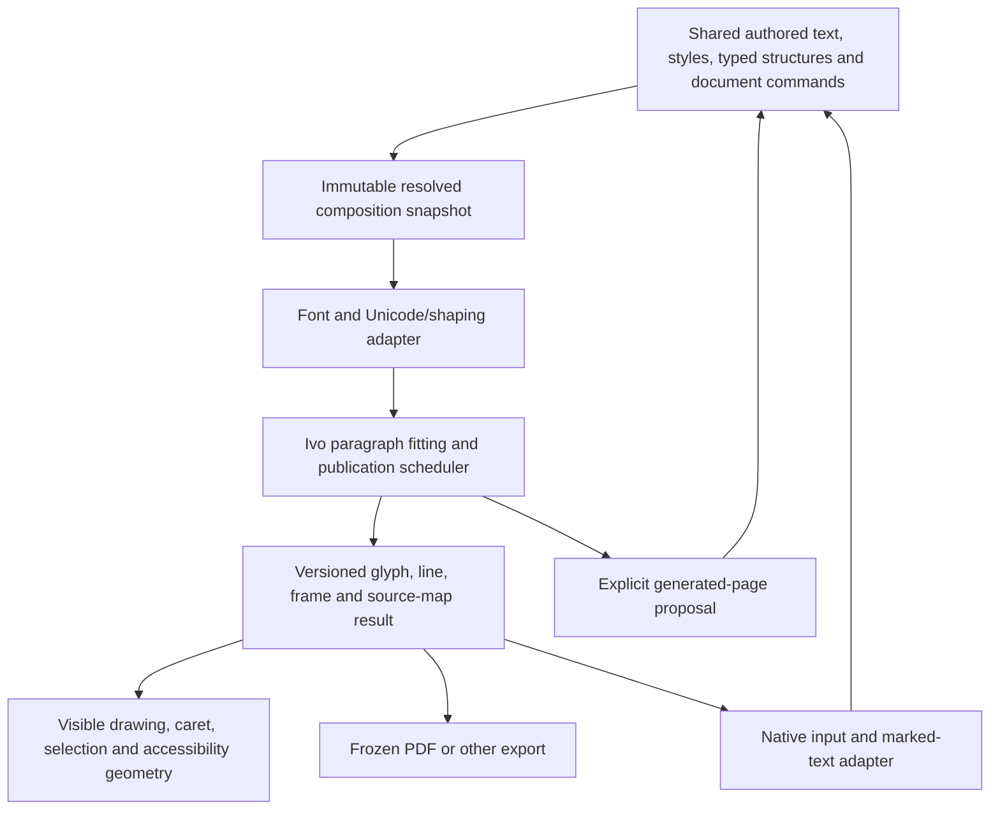

# Draft decision: one text composition authority, with a Core Text prototype

**Status: proposed; prototype required.** Researched 18 November 2026. No new composition engine, worker, native drawing surface or input adapter is implemented by this document. Existing first-baseline/selection improvements remain browser-derived working increments. This draft extends [the shared-engine decision](0001-shared-document-engine.md); it does not replace the shared document, storage, undo or knowledge model.

The first [native geometry/PDF proof](../indesign/native-composition-prototype.md) now runs separately from production: current-source maps, exact CMU resources, native glyph/caret geometry and same-line PDF output have bounded evidence. It exposes fallback and PDF ligature-extraction differences explicitly. This is partial P1/P2/P6 evidence; the paragraph scheduler, native presentation/input and mobile gates still block adopting a new layout authority.

The [66-capability programme](../indesign/text-parity-programme.md) requires more than font controls over browser layout. Whole-paragraph choices, custom spacing tolerances, contour exclusions, footnote/table pagination, parent text frames and vertical CJK rules need an owned composition pipeline. A low-level library may supply shaping and drawing, but it must not become another mutable document model.

## Proposed choice

**Build an engine-neutral semantic input/layout-result contract, then test one shared Swift/Core Text module on Mac and iPhone/iPad, with an Ivo-owned paragraph and publication scheduler.** Use the native prototype to decide the renderer/input bridge before migrating persisted source or replacing the current editor. Keep HarfBuzz + ICU + Skia/SkParagraph as the explicit alternative if the native route fails the determinism, rendering, input or portability gates below. Do not install or vendor either stack merely to make this draft concrete.

Core Text is the preferred first experiment because the supported product targets are Apple devices, the project already builds shared Swift font code, and the installed SDK supplies font, glyph-run, line-construction and caret primitives. This is an engineering choice about present integration cost, not a claim that Apple implements InDesign's composer. The decisive work is the owned paragraph/page policy and one shared result for visible text, selection and export.

The next substantial step is therefore a **headless Core Text glyph/geometry and selectable-PDF proof**, followed by an owned paragraph-to-page composition slice with an interactive input/rendering witness. The first proof establishes whether exact font bytes, source maps, caret geometry and export can share a result without changing persisted source. It does not claim paragraph optimization. The follow-on must demonstrate an owned paragraph decision that differs from greedy line wrapping and carry it into unequal frames and native input. More Properties controls cannot substitute for either step.

## Hard requirements

1. **One source.** Stable flow, paragraph, run, object/field/note and style IDs remain in the shared domain. Empty paragraph marks, soft/hard/frame/page breaks, sparse overrides, hidden conditions and overset content survive losslessly. Opening an older vault performs no source rewrite.
2. **One layout authority.** Reading, editing, hit testing, selection, generated-page proposals and export consume the same immutable composition result. The browser must not independently rewrap strings after native layout chose lines or glyph positions.
3. **Portable fonts.** Exact vault bytes, real companions, face/axis/feature choices and fallback identities are explicit. A machine-installed font name alone is insufficient. Existing embedding/resource limits and persist-before-reference transactions remain.
4. **Positions with affinity.** UTF-16 transport offsets, Unicode grapheme boundaries, shaping clusters, visual caret positions and paragraph/typed-content boundaries are distinct. Many-to-many source/glyph maps and both sides of a directional boundary must remain expressible.
5. **Owned layout policy.** Paragraph optimization, dictionaries/limits, word/letter/glyph spacing constraints, first baselines, grids, keeps, column flow, wraps, table splits and note-space allocation must be inspectable and testable as Ivo algorithms/policy. A library default is not automatically the requested rule.
6. **Immediate interaction.** Camera/selection response does not wait for full-document composition, font enumeration, process launch or IO. Background results are bounded, cancellable and generation-fenced. Retain the current smooth movement of frames and vector appearance during zoom.
7. **Native input and accessibility.** IME marked text, candidate windows, screen-coordinate caret/range queries, dictation, autocorrect, touch selection and accessible reading order remain first-class. Custom drawing does not excuse a hidden input whose geometry disagrees with the visible text.
8. **Safe publication.** Frozen snapshots render without mutating an open document. PDF retains searchable/selectable text, correct glyph-to-Unicode mapping, original font resources, links and future tags; outlining every glyph is not a complete PDF solution.
9. **Cross-device recovery.** Native code derives layout; it never writes a vault, resolves a cloud conflict, changes stable IDs or owns undo. Layout failure leaves source recoverable and does not silently substitute a weaker writer.
10. **Evidence before equivalence.** Compare controlled source/font/settings/geometry fixtures against a named InDesign reference build and against all supported Apple targets. Passing internal consistency tests does not establish identical Adobe behavior.

## Candidate feasibility

| Candidate                             | Useful capability                                                                                                                      | Essential missing work / integration cost                                                                                                                                                                                                                                               | Proposed role                                                                                                                                                                                      |
| ------------------------------------- | -------------------------------------------------------------------------------------------------------------------------------------- | --------------------------------------------------------------------------------------------------------------------------------------------------------------------------------------------------------------------------------------------------------------------------------------- | -------------------------------------------------------------------------------------------------------------------------------------------------------------------------------------------------- |
| Extend browser DOM/CSS composition    | Existing rich input, browser shaping, live selection, accessibility tree and current builds; lowest short-term migration cost          | Ivo can measure resulting lines but cannot treat general CSS flow as an explicit custom paragraph optimizer or full publication scheduler. DOM Range measurements and hidden source projection are expensive authorities for large incremental layout. Browser/OS layout versions vary. | Keep as current editor and comparison/fallback development backend while the prototype is evaluated. Do not certify the full composer by adding CSS-backed controls.                               |
| Shared Core Text module               | Public Apple font/shaping/line/glyph/caret APIs; a common low-level implementation can serve Mac and iOS                               | No ready-made Ivo publication model or proven InDesign-equivalent paragraph optimizer. Requires own breaks/fit/pagination, native bridge, exact rendering/export integration and real device tests. OS versions can differ.                                                             | **First prototype**, conditionally selected for Apple shaping/line measurement and glyph drawing beneath owned composition policy.                                                                 |
| TextKit 2 / native text views         | Higher-level Apple layout/input infrastructure, viewport rendering and custom elements                                                 | AppKit/UIKit hosts and rich editing behavior become substantial native integration work. Adopting native text storage as another authority would violate shared-domain ownership. No evidence here that its standard layout supplies the full requested publication policy.             | Input/accessibility adapter candidate and technical comparison. Do not replace the document model with NSTextStorage/NSTextContentStorage or adopt a native view wholesale without the same gates. |
| HarfBuzz + ICU + owned composer       | A portable shaping/Unicode foundation with explicit buffers and cluster maps; can be built for native/WASM targets with owned versions | Font fallback, bidi/run itemization, breaking dictionaries/policies, paragraph fitting, pagination, drawing, input and accessibility still need integration. More build/dependency/data ownership than the Apple-only experiment.                                                       | Strong alternative when pinned cross-platform behavior or browser parity outweighs native integration cost. Shape/Unicode primitives, not a ready InDesign engine.                                 |
| Skia/SkParagraph, native or CanvasKit | Paragraph layout, range/hit-test APIs and a rendering stack; CanvasKit offers WebAssembly and hardware-accelerated drawing             | A paragraph API is not the required multi-frame/table/note publication scheduler. Confirm API/index/feature coverage and PDF build configuration; extra native/WASM payload, memory and upgrade work. Browser canvas still needs native-input/accessibility bridges.                    | Rendering/paragraph alternative to prototype against if Core Text cannot supply one usable browser/native presentation boundary.                                                                   |
| Pango layout stack                    | Paragraph formatting, line geometry, bidi/caret operations and existing renderer backends                                              | Additional GLib/Pango/font/render integration on Apple, plus the same owned publication policies. Its UTF-8 byte indices need explicit conversion to Ivo's UTF-16 positions. Current Apple hosts do not contain this stack.                                                             | Viable comparison, lower priority for this Apple-focused project. No installation selected.                                                                                                        |

Core Text's public overview describes a low-level framework and permits concurrent calls when shared parameters are not being mutated; it also identifies cross-platform graphics-context differences. Immutable inputs and isolated jobs are therefore a reasonable design, but this documentation is not a benchmark or proof of thread safety for mutable Ivo state. [Apple Core Text overview](https://developer.apple.com/library/archive/documentation/StringsTextFonts/Conceptual/CoreText_Programming/Overview/Overview.html).

TextKit 2 exposes custom text elements, layout fragments and viewport layout infrastructure. That makes it relevant to native text interaction, but does not establish the required page composer or a drop-in bridge for Electron/Capacitor. [Apple TextKit 2 sample](https://developer.apple.com/documentation/UIKit/using-textkit-2-to-interact-with-text).

HarfBuzz's own manual limits its responsibility to shaping runs; it explicitly leaves bidi organization, differently styled runs, line breaking, hyphenation and justification to surrounding code. ICU supplies Unicode/locale boundary analysis, including dictionary boundaries for several languages, but boundary candidates are not a complete hyphenation/publication policy. [HarfBuzz scope](https://harfbuzz.github.io/what-harfbuzz-doesnt-do.html), [ICU boundary analysis](https://unicode-org.github.io/icu/userguide/boundaryanalysis/).

SkParagraph exposes paragraph layout/paint, range rectangles, hit testing and line metrics; CanvasKit packages Skia for WebAssembly with a hardware-accelerated surface. These are useful primitives, not evidence of InDesign line choices, note allocation or an automatically available selectable PDF path in a chosen CanvasKit build. [SkParagraph interface](https://github.com/google/skia/blob/main/modules/skparagraph/include/Paragraph.h), [CanvasKit overview](https://docs.skia.org/docs/user/modules/canvaskit/), [Skia native PDF backend](https://docs.skia.org/docs/user/sample/pdf/).

Pango documents paragraph line breaking, justification, alignment and logical/physical position conversion. Its line source ranges use UTF-8 byte indices, which must not be confused with Ivo offsets. [Pango Layout](https://docs.gtk.org/Pango/class.Layout.html), [Pango LayoutLine](https://docs.gtk.org/Pango/struct.LayoutLine.html).

None of the evaluated interfaces supplies Ivo's entire 66-capability publication model. Selecting one does not eliminate the need for semantic content, paragraph policy, pagination, editing commands and verification.

## Local Apple SDK evidence and limits

The read-only SDK inspection used `/Library/Developer/CommandLineTools/SDKs/MacOSX.sdk`, whose settings identify macOS SDK 26.2. The installed public CoreText headers declare the following primitives, with Mac/iOS availability annotations. This is API feasibility evidence, not execution or a physical iOS build.

| SDK declaration                                                                                         | What it enables in a prototype                                                                         | What it does not establish                                                                                   |
| ------------------------------------------------------------------------------------------------------- | ------------------------------------------------------------------------------------------------------ | ------------------------------------------------------------------------------------------------------------ |
| `CTTypesetterCreateLine[WithOffset]`, `CTTypesetterSuggestLineBreak`, `CTTypesetterSuggestClusterBreak` | Construct/measure explicit source ranges; inspect suggested width breaks and cluster-safe alternatives | Global paragraph optimization, dictionary hyphenation, custom fit penalties or complete line-context policy  |
| `CTLineGetGlyphRuns`, `CTRunGetGlyphs`, `CTRunGetPositions`, `CTRunGetStringIndices`, run attributes    | Extract actual glyph IDs/positions and source indices with the resolved font                           | A complete grapheme/ligature/bidi caret map, editable source semantics or portable font fallback capture     |
| `CTLineGetStringIndexForPosition`, `CTLineGetOffsetForStringIndex`, caret enumeration                   | Native line hit testing, primary/secondary directional offsets and caret candidates                    | Multi-frame selection, page/column navigation or a single-caret simplification at bidi boundaries            |
| `CTLineCreateJustifiedLine`                                                                             | A justified line primitive                                                                             | The user's full min/desired/max word/letter/glyph constraints or Adobe's paragraph decisions                 |
| `CTFrame` paths and clipping-path attributes                                                            | Nonrectangular frame/exclusion experiments                                                             | Complete contour-wrap side, stack, anchor and flow rules or convergent note/table layout                     |
| Vertical-form attributes, horizontal-in-vertical forms and frame progression                            | Experiments with vertical glyph forms and direction                                                    | Complete kinsoku/mojikumi/ruby/warichu and vertical editing policy                                           |
| `CTFontCreatePathForGlyph` and Core Graphics drawing                                                    | Inspect glyph paths and draw explicit positioned glyphs                                                | A universal path representation for every color/bitmap font or searchable PDF when only outlines are emitted |

Apple's manual-line-breaking examples corroborate that applications can choose explicit line ranges and nonrectangular containers. They do not describe an InDesign-compatible optimizer. [Apple common layout operations](https://developer.apple.com/library/archive/documentation/StringsTextFonts/Conceptual/CoreText_Programming/LayoutOperations/LayoutOperations.html).

The existing [SystemFonts.swift](../../src/platform/apple/SystemFonts.swift) only enumerates/exports font data. It is not a text-layout engine. Reuse its bounded font identity/resource practices and shared build ownership, not its one-process-per-request transport for interactive composition. Private Apple interfaces and undocumented Adobe internals are not part of the proposed contract.

## Source and layout boundaries

### Authored model

Keep command semantics, style references/overrides, links, knowledge identity, undo and storage validation in the shared JavaScript domain. Introduce a lossless semantic adapter before changing persisted source: paragraphs with explicit marks, sparse run attributes and stable typed atoms/children for anchors, cells, notes, fields and hidden content. The current canonical HTML remains the stored authority until a separately versioned migration is tested. Never keep a mutable HTML source and a mutable native attributed string as competing masters.

The bridge's text buffer can use UTF-16 to match JavaScript/Apple APIs, but it must carry a source map. Existing virtual block boundary offsets do not automatically equal offsets in a normalized attributed string. Typed objects, paragraph marks, generated hyphens/labels and hidden conditions need explicit source/display mapping; no implicit Unicode normalization or flattening is permitted. Grapheme, shaping-cluster and visual caret boundaries remain distinct even when they coincide in simple Latin text. [HarfBuzz cluster documentation](https://harfbuzz.github.io/working-with-harfbuzz-clusters.html).

Resolve ordinary named styles into immutable sparse/effective runs at the boundary. Pass bounded declarative layout-dependent rules for nested/line styles; do not send JavaScript callbacks or executable regex/code across a native bridge. The later rule engine must define language/regex behavior and reflow invalidation explicitly. Native composition returns derived appearance and diagnostics, never rewritten style definitions.

### Composition input

A request identifies its protocol/capability version, document/flow/source revisions, composition policy version, exact fonts and features, paragraph/typed-content data, and the relevant geometry. Include unequal frame order, insets, first-baseline/grid/vertical settings, exclusions and publication constraints. Resources are digested bounded bytes or acknowledged process-local resource handles; renderer-supplied filesystem paths are not a font or output API.

Cache keys include relevant source/style/geometry versions, exact font data/face/axes, shaping/backend and OS build, Unicode/break/hyphenation policy/data versions and composer settings. Camera zoom, viewport scroll and selection do not alter authored text metrics and must not force paragraph recomposition. Viewport changes can request more cached display data without changing the publication.

### Composition output

Return an immutable versioned result containing paragraph/source ranges, line breaks/baselines/ascent/descent, frame/column placement, actual glyph runs and font identities, cluster maps, primary/secondary caret stops, range rectangles or enough geometry to derive them, generated display atoms, exclusions/overflow, and diagnostics. A result must identify precisely which input generation and resources it describes.

Return changed paragraphs/frames and visible/adjacent geometry incrementally after the first snapshot. Do not shuttle every glyph in a long publication on each keystroke. Retained native handles are process-local caches, not vault IDs. A worker crash discards them; source and font bytes reconstruct the same request. Jobs from a stale document, font set, writer session or geometry generation cannot publish into a new view.

Generated pages are a proposal consumed by a validated shared-domain command under the existing automatic-flow policy. They do not authorize the worker to delete authored pages, write storage or repaginate a live document during PDF export.

## Paragraph and publication policy owned by Ivo

A viable implementation needs more than accepting a library's suggested next line:

1. Build legal/forced break candidates and discretionary display choices from source/script/language policy. Reshape around selected breaks where context requires it; glyph clusters alone are not always safe break sites.
2. Measure line alternatives with actual font runs and the requested word/letter/glyph limits. Compute explicit badness/penalties, choose whole-paragraph paths with bounded work, and keep a separate single-line policy. Expose impossible constraints as diagnostics instead of silently ignoring settings.
3. Place chosen lines into available horizontal intervals from frame geometry, inset, grid, contour exclusions and paragraph span/split rules. Empty paragraphs and paragraph marks participate in baseline/spacing rules.
4. Schedule keeps, columns, anchors, tables/cell flows and footnote/endnote allocations. These can feed back into available line space; define deterministic stabilization, termination and overflow rules rather than an unbounded retry loop.
5. Add vertical/CJK and editorial generated-content policies against the same typed source and geometry interfaces. Do not present vertical glyph orientation alone as complete Japanese composition.

Core Text can supply measurements and explicit lines for this work. Whether it exposes all measurements/control needed for every requested fitting and international policy is an open prototype question. Core Text line results and a portable HarfBuzz-backed adapter can share the same higher-level request/result contract, but their equivalence must be tested rather than assumed.

## Native transport, drawing, input and export

### Transport and scheduling

For the first headless proof, use an owned bounded executable and saved synthetic requests. For an interactive experiment, use a **persistent** supervised Mac utility worker or native module off the renderer/main UI thread, and the same Swift module behind an asynchronous iOS native port. Compare the persistent-worker and in-process costs before committing to one deployment design. Current Electron/Capacitor IPC remains orchestration, not a synchronous call per glyph/line.

Snapshot mutable inputs before crossing threads. Queue/cancel by flow revision, prioritize active-paragraph/near-viewport work, and bound caches and worst-case paragraph alternatives. The native module cannot independently accept document edits or reuse a result after owner/vault changes. The existing font process does not become a general arbitrary-command server.

### Visible text and input

There are two serious rendering experiments, not an already chosen implementation: a native Core Graphics text surface integrated into the Mac/iOS host, or a shared browser vector display list that draws explicit glyphs without reshaping source strings. Test both against the same geometry. Native surfaces have interleaving/transform/window integration costs in Electron and Capacitor; browser glyph paths have color-font, payload, selection and accessibility costs. Re-emitting native line strings as ordinary DOM text can silently re-shape/rewrap them and therefore does not pass the authority gate.

Do not scale a stale text bitmap during pinch. The drawing path must retain/rerender glyph information at the current transform while camera response stays immediate. Ordinary glyph outlines alone do not cover all color/bitmap fonts; unsupported representation must be diagnosed and a faithful drawing path established.

Retain the existing input owner during the first slice. Treat native/browser typing as commands into the shared source, with marked text kept transient until commit/cancel. If its candidate/caret geometry cannot follow the authoritative layout, implement a dedicated input adapter rather than positioning an unrelated hidden text box. UIKit's custom input contract includes positions/ranges, hit testing, marked text and caret/selection rectangles; AppKit also queries screen-space character-range rectangles. These obligations must be tested on physical devices. [UITextInput](https://developer.apple.com/documentation/uikit/uitextinput), [AppKit character-range rectangles](https://developer.apple.com/documentation/appkit/nstextinputclient/firstrect%28forcharacterrange%3Aactualrange%3A%29).

### Export and accessibility

The same frozen layout must drive visible text and PDF glyph placement. A native Core Graphics PDF emitter is a candidate; the prototype must verify embedded font resources and glyph-to-source Unicode mappings independently. Drawing all glyphs as paths preserves shape but loses searchable text and is not the accepted export. Skia's native PDF backend is an alternative only with its actual build/integration tested; the existence of its documentation does not prove a default CanvasKit package exposes that path.

Links, text destinations, reading order, tags, notes and hidden/generated content come from source semantics plus the layout map, not pixel inspection. An accessible semantic layer is still required when the visible surface is custom drawn. The publication engine may omit a hidden condition from paint while preserving its complete source.

## First engine milestone: native geometry and PDF proof

Implement the narrow proof after the text-core milestone, without changing the saved text representation or production editor backend:

1. Define a versioned, bounded request containing current canonical text through a lossless adapter, sparse/effective runs, exact font resource digests/bytes, declared point units and two unequal frame constraints. Keep the original source and an explicit logical-to-attributed-string offset map.
2. Use public Core Text to construct actual lines and return glyph IDs/positions, resolved run fonts, source indices, line/baseline metrics and dual caret/range geometry. Persist only synthetic request/results as test artifacts; native caches remain disposable.
3. Produce a native PDF from those same frozen glyph/line results. Independently inspect font embedding, Unicode extraction, line positions and links. Outline-only or rewrapped DOM output does not pass.
4. Verify source/font hashes, repeatability and controlled failures for a missing/prohibited font, stale result or malformed map. Run Mac first; add the shared iOS build/device witness before claiming cross-device operation.

This closes a useful subset of P1/P2/P6 below and answers the highest-risk geometry/export questions first. Label it **Core Text geometry/PDF proof**. It does not close P3/P4, implement a whole-paragraph optimizer, replace the editor or justify marking the full parity programme complete. No source migration is needed to start it.

## Decisive prototype gate

Create one isolated, checked-in synthetic fixture corpus with licensed shipped fonts and one permitted external-font fixture. Keep native reference documents/captures private; record only original public-safe expected contracts and metadata. No personal vault or application preference changes are part of the gate. All numbers below are **proposed engineering acceptance budgets**, not measured results or claims about InDesign.

| Gate                                  | Decisive experiment / required result                                                                                                                                                                                                                                                                                                                                                                                                                                                                                                                                                                       |
| ------------------------------------- | ----------------------------------------------------------------------------------------------------------------------------------------------------------------------------------------------------------------------------------------------------------------------------------------------------------------------------------------------------------------------------------------------------------------------------------------------------------------------------------------------------------------------------------------------------------------------------------------------------------- |
| **P1 — Source/position identity**     | Load existing HTML through the semantic adapter without rewriting it. Cover empty/final paragraphs, soft/hard breaks, surrogate/combining/ZWJ text, ligatures, RTL, an inline atom and hidden text. Every legal caret/range maps into source and back; disallowed cluster interiors are explicit; undo/source/asset hashes remain unchanged under layout.                                                                                                                                                                                                                                                   |
| **P2 — Native shaping/line data**     | On Mac and at least one iPhone and iPad, use the same font bytes/settings and export glyph IDs, source indices, advances/offsets, resolved fallback faces and dual caret geometry. Include Latin ligatures, Arabic/Indic combining behavior, emoji/color glyphs and vertical Japanese forms. Missing mappings or unavailable font resources fail with diagnostics, not guessed positions.                                                                                                                                                                                                                   |
| **P3 — Owned paragraph decision**     | Implement a bounded paragraph optimizer over measured candidates and a separate greedy/single-line policy. Include a controlled paragraph where global cost chooses a different earlier break. Verify exact mandatory breaks, justified spacing constraints, discretionary hyphens, widow/orphan and impossible-fit handling. Record each chosen alternative/cost so one matched screenshot cannot masquerade as the algorithm.                                                                                                                                                                             |
| **P4 — Page scheduler interaction**   | Compose through three unequal frames with a contour exclusion and explicit baseline grid; add one typed table row group and a footnote allocation that changes available body space. Verify deterministic stabilization, no clipped/lost source, exact thread order and preserved overset. This is a vertical slice proving the architecture can represent feedback, not completion of tables/notes/CJK.                                                                                                                                                                                                    |
| **P5 — Presentation/input authority** | Render one result in the actual Electron and Capacitor hosts; hit/select backward/forward across frames, type with IME, drag frames, pinch and reopen. Native candidate windows and touch selection match visible glyphs. Compare native and browser-vector witnesses where feasible. If neither gives faithful, responsive integration, reconsider the backend before a production migration.                                                                                                                                                                                                              |
| **P6 — Same-result export**           | Export that immutable result to PDF, then inspect text/font/Unicode resources and independently render/extract it. Page/line/glyph placement agrees with the visible result; links and source text survive; export leaves live source/pages unchanged. An outline-only PDF fails.                                                                                                                                                                                                                                                                                                                           |
| **P7 — Responsiveness and bounds**    | Record hardware/OS, warm/cold cases and profiler traces. Target active-paragraph edit-to-visible update p95 ≤16.7 ms and p99 ≤50 ms, selection/camera feedback on the next display frame, and no full-publication work on the input thread. Target warm bridge overhead p95 ≤2 ms. For a 100,000-character/100-frame synthetic publication, initial composition target ≤500 ms on the recorded Mac and ≤1 s on recorded mobile targets, with bounded memory and cancellation within one scheduling quantum. Revise budgets openly if device evidence justifies it; do not relabel slow frames as immediate. |
| **P8 — Reference/determinism**        | Compare declared source/font/settings against the named InDesign reference and record geometry/behavior differences. Use initial 0.1 pt baseline/advance-difference diagnostics for controlled metric cases, not a blanket parity tolerance. Compare repeat runs and supported OS versions; unexplained reflow fails. Decide whether OS-version-dependent Core Text output is acceptable or requires pinned portable shaping/policy.                                                                                                                                                                        |

The first geometry/PDF milestone may ship as an isolated engineering proof before the remaining gates are implemented. P1–P6 are blockers for adopting the new composition authority, not optional later polish. P7 supplies the performance decision; P8 determines which differences remain before parity can be claimed. Passing the gate authorizes an incremental implementation/migration plan, not all 66 capabilities. If the Core Text route fails P5 or P8, run the same corpus through a pinned HarfBuzz/ICU + Skia candidate rather than hiding discrepancies under browser measurements.

## Rollout after the gate

1. Publish the original request/result schema and headless corpus, build the smallest native slice and record measured results. No authored format upgrade is required for disposable prototype data.
2. Select a presentation/input path from P5 and a determinism policy from P8. Pin native/portable dependencies and data only after their distribution/build/licensing review; preserve notices and keep private/proprietary reference artifacts outside Git.
3. Introduce the semantic source representation only when it carries existing and next required structures losslessly. Add a capability version, frozen old-format migrations and rollback/read-only handling. Do not automatically upgrade old notes on open.
4. Move one declared document capability at a time onto the authority, preserving source, font bytes, undo and generated-page ownership. Run differential old/new regression fixtures and reject unsupported edits explicitly. Never mix native and browser line placement inside one authoritative flow.
5. Implement the rest of the programme in dependency order, using the same source, scheduler, map and export contracts. A standalone browser build may retain the present backend for supported documents; it cannot silently rewrite a document requiring unavailable composition capabilities.

## Remaining unknowns and costs

- Core Text's exact shaping/line behavior across supported OS versions, all variable/OpenType/AAT/color-font cases and portable fallback bytes has not been measured by this ADR.
- The minimum native deployment version and device performance matrix must be selected and tested; a macOS SDK header with iOS availability is not a device build.
- Native-surface composition with Electron/Capacitor scrolling, clipping, graph layers, panels and transforms may dominate integration cost. The browser-vector alternative has a different font/payload/accessibility burden.
- Complete CJK/vertical, optical/per-pair fitting, language dictionaries, large tables, notes, text paths, nested/line rules and accessible publication remain substantial owned engine work whichever library is selected.
- A platform system engine is easier to ship for Apple targets but cannot be version-pinned like a bundled open-source stack. A future non-Apple product or strict cross-OS byte-identical layout requirement would materially change this choice.
- IME, autocorrection and assistive technologies have synchronous geometry/query expectations while shared commands/layout are asynchronous. The adapter needs a coherent current/marked snapshot and cannot rely on a delayed worker response for every native query.
- Budgeted optimization and bounded fixed-point pagination must return explicit overflow/constraint diagnostics on pathological inputs. An arbitrary retry count followed by silent source/layout loss is unacceptable.

This draft commits to a falsifiable next experiment and ownership boundary. It does not assert that Core Text, TextKit, HarfBuzz, Pango or SkParagraph reproduces InDesign, and it does not turn the existing browser foundation into a complete publishing engine.
