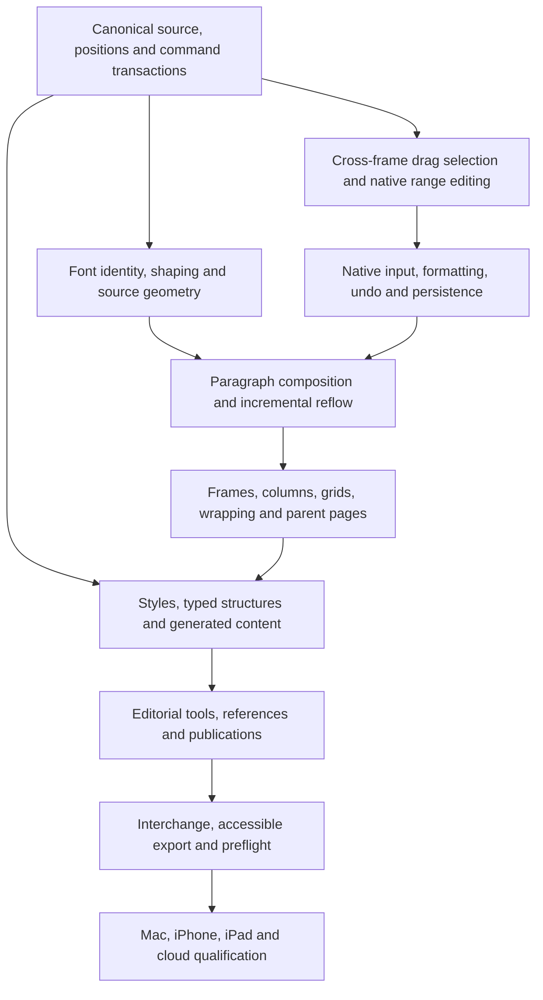

# InDesign text parity programme

Engineering acceptance baseline: 18 November 2026, source commit `2af325e`. This is Ivo's implementation programme, not recovered Adobe source or a claim that parity is complete. The [publishing foundation](../publishing-foundation.md), [text composition plan](text-composition-plan.md), [text flow](../text-flow.md) and [verification record](../verification.md) remain the evidence for earlier increments.

The release ledger contains 63 capability IDs. Three specialist language capabilities from the original 66 are recorded in the [broader-edition wishlist](#broader-edition-wishlist). Word import remains deferred. Adobe's online font service, Generate/Rewrite/Fit Text and other AI actions are excluded. Existing local/system/vault fonts remain included. These exclusions do not remove the underlying text layout, selection, fit-to-content, style or font-resource requirements. InDesign is the behavioral reference; Ivo retains its own palette and Geist interface font, CMU Serif as the new-text default, its linked-note graph and the existing smooth Illustrator-like movement of frames.

A visible control, a stored attribute, a successful browser render and an observed native InDesign behavior are four different kinds of evidence. None alone establishes feature parity. Rows below state **Foundation** where a bounded Ivo implementation exists and **Open** where the capability or its essential fidelity is missing. No row is currently certified as full InDesign parity. A future completion entry must name the exact tested implementation commit, reference build, fixture and remaining differences.

Post-baseline increments: commit `693f2dc` delivers the [linked-selection/native-formatting milestone](../text-interaction-core.md) and [measured first baselines](../frame-composition.md), verified with 222 units and 33 desktop groups across retained runs. The subsequent isolated [Core Text geometry/PDF proof](native-composition-prototype.md) supplies bounded source/font/glyph/caret/export evidence and identifies fallback/extraction limits. The capability tables below retain the original acceptance baseline; neither increment certifies full parity or replaces the remaining programme.

The [native composition editor preview](../native-composition-editor.md) now connects that engine to real page ink, caret/range geometry, retained native input, continuation pages, undo, saved source and selectable PDF. Authoring the explicit per-flow choice opts into archive 8 / canvas 7; old notes keep their previous composer. Actual-editor regressions include trusted cross-page selection/typing, partial italics through fresh archive reopen, delayed-result/writer-lease fences and unsupported-control rollback. This advances the common engine prerequisite. It does not complete the feature rows below, the broader InDesign visual/behavioral comparison or physical mobile/IME qualification. [Incremental paragraph reflow](../incremental-paragraph-reflow.md) now reuses unchanged exact-font measurements and decisions and treats each paragraph ending independently. Smaller final geometry payloads, incremental final layout, wider paragraph policy, font fallback and script coverage remain engine dependencies.

## Early language and math priorities

These document-content requirements apply across the release ledger, including shaping, input, font fallback, selection, reflow and PDF export.

- **Everyday authoring:** English, Spanish, Russian, Italian and Greek. Cover Latin, Cyrillic and Greek text together in a paragraph, including accented letters and combining marks. Exercise typing, selection, deletion, reflow across linked frames, undo, save/reopen and searchable PDF. Track dictionaries and proofing separately from ordinary editing.
- **Occasional European text:** Turkish, Czech, Hungarian and other European languages as needed. Use short passages with real spelling in the same editing and export checks. Examples include Turkish `İstanbul` and `ışık`, Czech `Příliš` and Hungarian `tűző`.
- **Occasional Chinese:** target short horizontal names and phrases alongside European text. Check input-method commit/cancel, font fallback, editing, vault reopen and copying the original characters from PDF. Use a short example such as `上海` in a caption.
- **Occasional names in other scripts:** exercise a short name in a mixed-direction caption using platform shaping and ordinary reading order. Check selection, copy/paste, vault reopen and PDF copy. The shared input, font and export capabilities own these checks.
- **Mathematics:** include ordinary Unicode symbols such as `ℵ₀`, `∀` and `∈` in mixed-text font, copy and PDF checks. Editable LaTeX-style inline and display equations remain a later release milestone, with a proof containing `\aleph_0` as a representative use case.

## Current priority: wrapping enables user fixtures

Object text wrapping is now a high-priority prerequisite for representative user layouts. The [first usable increment](../object-text-wrap.md) delivers box/polygon exclusions across existing-layout editing and PDF; editable wrap paths and further reference qualification remain ahead of unrelated UI work. The dependency order below still governs correctness, but absence of user fixtures must not block the features needed to create them.

## Order of work

1. **Source and command contracts.** Fix the coordinate, selection, paragraph-mark, style and undo contracts first. The existing canonical HTML can continue to store source while adapters expose the required logical positions; introducing a new persisted representation requires a versioned migration and frozen fixtures. A large format replacement must not become a prerequisite for the first usable cross-frame selection increment.
2. **Selection and native input.** Drag selection across the linked flow is the first interaction milestone after logical positions. Follow it with range formatting, command routing, keyboard movement, clipboard, composition and persistence checks. Complete the reported native italic regression here. This protects every later formatting feature from relying on the wrong range or scope.
3. **Fonts, shaping and composition.** Establish source-to-cluster/line geometry and one layout result for editing, preview and export. Then implement paragraph optimization, hyphenation, spacing limits, composition for the release languages and invalidation. Browser typography is the present foundation, not evidence that these engines are already implemented.
4. **Frame and page composition.** Build baseline/inset/grid/vertical rules, unequal columns, smart reflow, wrapping and primary parent frames on the composition result. Geometry edits must never replace source typography.
5. **Styles and structured content.** Complete style breadth, tabs/lists, tables, anchored objects and paths. Derive generated appearance from source; never turn generated numbers, leaders or fields into literal text unless the user explicitly converts them.
6. **Editorial and publication systems.** Add scoped search/proofing, notes/revisions/conditions, dynamic fields, references, indexes, books and merge. These depend on stable source ranges and typed embedded content, not on flattened display strings.
7. **Interchange, accessibility and release qualification.** Export and import use the same source/composition authority. Finish preflight, packaging, responsive reading and cross-device/cloud recovery, then run the complete acceptance suite before the user's broad in-app review.

Independent work can proceed after its prerequisites are stable. Each verified milestone is committed and synced through the standing Git workflow; there is no requirement for the user to review each feature. Failures discovered during implementation enter the same acceptance suite and dependency order rather than becoming an unrelated stream of patches.

## First interaction milestone: select across a linked flow

A selection belongs to one logical text flow and has an anchor and focus with direction/affinity. Frames and pages expose intervals of that source. Physical page order, z-order and the order in which a pointer touches boxes must not silently replace the flow's thread order. A second, unrelated flow is not part of the same selection.

The acceptance fixture must contain at least three sequential frames on separate pages, unequal widths, a multi-column frame, a nonsequential visual arrangement, another unrelated flow, mixed fonts/emphasis, empty paragraphs, soft and explicit breaks, links, emoji/combining text and overset source. Start in the middle of frame 1 and drag into the middle of frame 3: the selected interval includes the intervening source in frame 2 even if the pointer did not pass over its rectangle. Paint only the corresponding glyph/line regions in each visible frame. Drag backward and reverse direction during the same gesture; shrink, extend and cancel the range without changing text or history.

Required variants include Shift-click, character/word/paragraph granularity, trackpad pan and zoom, scrolled/offscreen frames with autoscroll, resize/reflow during a retained selection, pointer release outside the app, Escape, lost capture and composition protection. Pointer movement over a thread port, resize handle, contextual bar or panel must not accidentally start object creation or move a frame. Reference observations must establish behavior in gaps and at flow endpoints; do not guess those details from the screen arrangement.

A selected range must survive a Properties/contextual action, receive formatting exactly once, copy/cut all selected source, accept replacement text, and undo/redo as one coherent command. Native selection state, painted fragments, inspector mixed/uniform feedback and saved source must agree. Merely keeping an invisible canonical DOM range while showing no selection on other pages does not satisfy this milestone.

### Reported italic regression belongs to this milestone

The previous correction proves that stale frame defaults caused one preview inconsistency. It does not establish that all italic defects are fixed. The user's newer reproduction—select part of the text, press Command-I, then deselect, reproduced across app launches—is an open formatting/command/persistence acceptance case.

Exercise the real native shortcut and menu action as well as the contextual button and inspector. Capture the exact logical range, source run/paragraph defaults, effective font face and insertion style before and after the action. Then deselect, enter/leave the frame, switch reading/editing, move/resize the frame, save, close and reopen the vault. Only the selected text may change emphasis; sibling runs, later paragraphs and later frames must retain their prior styles. Undo/redo must restore source and selection. The baseline renderer intercepts Command-Shift-B/I/U locally while plain Command-I is not an explicit Ivo menu command; native browser formatting is therefore a separate route requiring observation. That is a source-level investigation lead, not a demonstrated root cause.

## Current evidence owners

The following references establish where behavior currently lives. Existing tests are regression evidence for their stated scenarios, not a complete differential suite against InDesign.

| Key             | Current implementation and bounded tests                                                                                                                                                                                                                                                                                  |
| --------------- | ------------------------------------------------------------------------------------------------------------------------------------------------------------------------------------------------------------------------------------------------------------------------------------------------------------------------- |
| Source          | [Text flows](../../src/domain/documents/text-flows.js), [schema](../../src/domain/documents/schema.js), [text-flow tests](../../tests/unit/text-flows.test.js), [migration tests](../../tests/unit/migrations.test.js)                                                                                                    |
| Positions/input | [DOM position map](../../src/shared/dom/text-selection.js), [flow projection](../../src/rendering/text/flow-input.js), [canvas coordinator](../../src/features/editor/canvas-editor.js), [text runtime](../../tests/runtime/text/fixture.js), [on-page input runtime](../../tests/runtime/document-text/fixture.js)       |
| Styles          | [Typed attributes](../../src/domain/text/typography.js), [style definitions](../../src/domain/documents/publishing.js), [range formatting](../../src/rendering/text/format.js), [effective selection style](../../src/rendering/text/selection-style.js), [publishing runtime](../../tests/runtime/publishing/fixture.js) |
| Fonts           | [Font metadata](../../src/domain/text/fonts.js), [font selection/persistence](../../src/features/editor/assets/installed-fonts.js), [shared Apple catalog](../../src/platform/apple/SystemFonts.swift), [font registrations](../../src/rendering/text/fonts.js), [font runtime](../../tests/runtime/fonts/fixture.js)     |
| Layout          | [Flow layout](../../src/rendering/text/flow-layout.js), [frame layout](../../src/rendering/text/layout.js), [page content](../../src/rendering/page-content.js), [layout runtime](../../tests/runtime/text-flow-layout/fixture.js), [inline metric runtime](../../tests/runtime/inline-metrics/fixture.js)                |
| Commands        | [Document history](../../src/domain/history/document-history.js), [object clipboard](../../src/domain/documents/clipboard.js), [native menu](../../desktop/main.mjs), [clipboard runtime](../../tests/runtime/clipboard/fixture.js), [interaction runtime](../../tests/runtime/interaction/fixture.js)                    |
| Pages/panels    | [Page commands](../../src/domain/documents/scene.js), [parents/layers](../../src/domain/documents/publishing.js), [publishing controls](../../src/features/editor/ui/publishing-controller.js), [panel owner](../../src/features/editor/ui/panels.js), [parent editor](../../src/features/editor/ui/parent-editor.js)     |
| Sharing/storage | [PDF snapshot](../../src/features/export/pdf-plan.js), [PDF renderer](../../src/features/export/pdf-renderer.js), [PDF runtime](../../tests/runtime/pdf/runner.mjs), [vault engine](../../src/storage/file-vault.js), [native byte adapters](../../src/platform/), [verification record](../verification.md)              |

## Capability acceptance ledger

### A. Source, positions, selection and commands

| Scope ID                | Baseline evidence / gap                                                                                                                                                       | Required acceptance before parity                                                                                                                                                                                                                  |
| ----------------------- | ----------------------------------------------------------------------------------------------------------------------------------------------------------------------------- | -------------------------------------------------------------------------------------------------------------------------------------------------------------------------------------------------------------------------------------------------- |
| `source-flow`           | **Foundation — Source.** One canonical HTML source per linked flow; frame fragments are derived. A semantic model for every richer structure is open.                         | Repeated thread/unthread/delete/duplicate/reflow operations preserve all source, style references, hidden/overset content and stable destinations; no per-frame source forks.                                                                      |
| `source-positions`      | **Foundation — Positions/input.** Logical UTF-16/path bookmarks exist; complete cluster/bidi affinity is open.                                                                | Map every insertion boundary through source, shaping, projection and reflow; handle surrogate pairs, combining sequences, ligatures and directional affinity without splitting a user character.                                                   |
| `paragraphs-breaks`     | **Foundation — Source, Styles.** HTML block/BR preservation exists; explicit paragraph-mark ownership and full break types are open.                                          | Empty/final paragraphs retain insertion formatting; distinguish paragraph, forced-line, column, frame, page and odd/even-page breaks through edit, export, clipboard and undo.                                                                     |
| `typed-content`         | **Open.** Ordinary objects and HTML text do not supply a complete typed inline-content model.                                                                                 | Preserve atomic anchors, fields, notes, table cells, special characters and protected/hidden content with stable IDs and valid range operations; reject unsupported writes without flattening.                                                     |
| `source-projections`    | **Foundation — Layout, Positions/input.** Active-frame projection retains canonical source and strips temporary markers on serialization.                                     | Every page/editor/reading/export view maps to the same source; copy, replace, composition and reconnect lose no offscreen or hidden content.                                                                                                       |
| `selection-hit-testing` | **Foundation — Positions/input.** On-page caret placement, word selection and canonical ranges exist; cross-frame pointer selection/painting is the first extension.          | Pass the complete linked-frame drag fixture above, keyboard extension, cluster hit testing in release text, including an occasional mixed-direction name, and transformed/zoomed coordinate cases, with zero authored writes from selection alone. |
| `text-input-ime`        | **Foundation — Positions/input, Commands.** Retained contenteditable and composition fences exist; physical device and international matrices remain.                         | Trusted Mac and iOS input covers marked text, candidate changes, cancellation, replacement, dictation, autocorrect, dead keys and focus transfer without duplicate commits or stale reflow.                                                        |
| `insertion-format`      | **Foundation — Styles.** Caret marks and empty-paragraph inheritance have bounded regressions; native shortcut routes remain open.                                            | Boundary-affinity, selected deletion, Return/soft break, empty mark, style changes and next typing retain the intended sparse formatting across frames and reopen.                                                                                 |
| `undo-commands`         | **Foundation — Commands.** Document/history ownership and atomic formatting, geometry and clipboard commands exist.                                                           | Native shortcuts, menu, panel and pointer routes produce identical changes and meaningful grouping across Return, IME, formatting, generated pages, structure edits and window handoffs.                                                           |
| `clipboard-drag`        | **Foundation — Commands.** Native object copy/cut/paste, text-range copy and resources have regressions. Rich/plain interoperability and selected-text drag/drop remain open. | Drag selected text within/across flows with move/copy modifiers and cancel; preserve complete source, marks and resources across native clipboard formats, vaults and devices; one undo command.                                                   |
| `editorial-view`        | **Open.** The unwanted bottom continuous-text pane was removed; on-page input is current.                                                                                     | If exposing continuous source editing, make it a deliberate command/view with synchronized logical selection, overset, notes/markers and undo. Never restore a second always-visible text authority or the removed pane by default.                |
| `layout-invalidation`   | **Foundation — Layout.** Signatures/cache guards exist; broad incremental composition and concurrent work are open.                                                           | Edit/font/resource/style/geometry changes invalidate only affected layout; a delayed result cannot replace newer source, caret or export; large flows maintain measured input latency.                                                             |
| `vector-rendering`      | **Foundation — Layout, Sharing/storage.** DOM text, retained camera and selectable PDF output exist.                                                                          | Rapid pan/pinch has no raster-text transition; editor and export consume the same glyph/layout result, preserving selection and hit targets under fractional zoom on target hardware.                                                              |

### B. Typography, fonts and composition

| Scope ID             | Baseline evidence / gap                                                                                                                                                                                                                                                                                                                                         | Required acceptance before parity                                                                                                                                                                                                        |
| -------------------- | --------------------------------------------------------------------------------------------------------------------------------------------------------------------------------------------------------------------------------------------------------------------------------------------------------------------------------------------------------------- | ---------------------------------------------------------------------------------------------------------------------------------------------------------------------------------------------------------------------------------------- |
| `font-resolution`    | **Foundation — Fonts.** System/vault faces, exact selected faces, companions and persist-before-reference exist; fallback capture and device breadth remain.                                                                                                                                                                                                    | Missing/restricted/fallback fonts are explicit; actual resolved glyph fonts, style names, fallback and vault resources survive device changes without silent substitution.                                                               |
| `size-leading`       | **Foundation — Styles, Layout.** Auto/fixed leading, percentage and repeated-size cleanup exist.                                                                                                                                                                                                                                                                | Match mixed-run line maxima, paragraph-mark leading, Auto/fixed toggles and font-change behavior through linked frames; repeat large/small cycles without metric ancestors changing the result.                                          |
| `spacing-baseline`   | **Foundation — Native layout/Styles.** Native indents/spacing, signed baseline shifts and character scale share glyph/caret/PDF geometry; advanced wrapping and device gates remain.                                                                                                                                                                            | Verify paragraph adjacency rules, baseline shift without unintended line growth, negative indents and mixed-script baselines under reflow, parent styles, import and export.                                                             |
| `kerning-tracking`   | **Foundation — Styles.** Tracking and metrics/no kerning render; optical/numeric values being accepted by validation do not implement their algorithms.                                                                                                                                                                                                         | Verify numeric pair kerning, optical/metrics modes, style precedence and tracking units at actual glyph boundaries with reference font pairs; no dropdown mode may silently render as another.                                           |
| `glyph-shaping`      | **Foundation — Native preview.** Exact-font Core Text glyphs, transforms and eight additional OpenType switches are integrated; language/fallback/complex-script policy remains open.                                                                                                                                                                           | Use verified font bytes and deterministic script/language/direction/features; inspect glyph IDs, clusters, advances and offsets, including fallback for the release language examples and ordinary horizontal shaping for a pasted name. |
| `source-glyph-maps`  | **Foundation — Native preview.** Source spans, glyph clusters, primary/secondary carets and partial-run decorations share one plan; complete script/visual-order coverage remains open.                                                                                                                                                                         | Map source ranges to every shaped glyph, caret stop and drawn line, in both directions, through ligatures, an inline mixed-direction name, and hidden or generated content.                                                              |
| `opentype-controls`  | **Partial.** Exact-face native features include the twenty independently selectable stylistic sets. Feature availability, inheritance, typing, undo and reopen have checks.                                                                                                                                                                                     | Test all supported substitutions/positioning, contextual alternatives, stylistic sets and glyph choices against actual font tables; show accurate selected/mixed state and preserve ranges.                                              |
| `variable-fonts`     | **Partial.** Declared variable coordinates drive native edges, advances, carets and PDF for bundled and vault fonts. Geist weights survive undo and cold reopen. Multi-axis faces and optical sizing need broader qualification.                                                                                                                                | All supported axes/named instances and combinations shape correctly, clamp according to metadata and persist portable font resources without pinning automatic defaults accidentally.                                                    |
| `line-breaking`      | **Foundation — Layout.** Bounded native scheduling owns source breaks across unequal columns and wrap fragments. Character No Break protects selected spaces and retains unplaceable source. Forced and discretionary line breaks and both nonbreaking spaces preserve their source. Discretionary hyphens, language and broader Unicode coverage remain.       | Inspect break candidates and resolved lines for Unicode, mandatory/discretionary breaks, nonbreaking characters, inline atoms, language and direction; consistent edit/preview/export results.                                           |
| `paragraph-composer` | **Foundation — Native layout.** Bounded owned paragraph optimization fits exact-font alternatives and first/rest widths; complete Adobe justified-paragraph policy remains open.                                                                                                                                                                                | Provide the requested paragraph and single-line composition policies; verify global paragraph decisions, penalties and predictable recomposition against controlled reference cases, not only matching one sample.                       |
| `hyphenation`        | **Partial.** Eight offline dictionaries and document-specific break rules feed both native composers. Original characters, generated glyphs and immediate reflow have checks. Extended prose qualification remains.                                                                                                                                             | Verify dictionaries, word/letter limits, consecutive hyphens, last-word/column rules, discretionary hyphens and source-to-drawn-hyphen mapping in edit, copy and export.                                                                 |
| `justification`      | **Partial.** All nine word/letter/glyph preferences share measured line, caret and PDF placement. InDesign matches 169/210 whole comparison columns. Emergency compression and paragraph choices still differ.                                                                                                                                                  | Match line/last-line behavior under measured spacing tolerances and composer policies, including single-word lines, spacing in the release languages and overset diagnostics.                                                            |
| `keep-rules`         | **Foundation — Native layout/Styles.** Whole paragraphs, chained headings, one to five following lines and keep with previous work through styles, reflow and PDF. Section starts support the next column, frame, page and page parity. Minimum opening and closing line counts reflow across unequal frames. Table/notes and device qualification remain open. | Verify keep-with-next counts, keep-first/last/all lines, start paragraph in next column/frame/page and impossible constraints across unequal frames and notes.                                                                           |

### C. Frames, pages and flow geometry

| Scope ID                 | Baseline evidence / gap                                                                                                                                                                                                                              | Required acceptance before parity                                                                                                                                                       |
| ------------------------ | ---------------------------------------------------------------------------------------------------------------------------------------------------------------------------------------------------------------------------------------------------- | --------------------------------------------------------------------------------------------------------------------------------------------------------------------------------------- |
| `page-geometry`          | **Foundation — Pages/panels.** Fractional points, mixed page sizes, page commands and geometry exist; full spread/section behavior remains.                                                                                                          | Explicit units, pages/spreads/origins, margins/bleed, rotation and transforms preserve text geometry, links and logical selection; changing page size never corrupts source.            |
| `text-frames`            | **Foundation — Source, Layout.** Area frames, point/area conversion, ports, overset and smooth movement exist.                                                                                                                                       | Verify handle/port hit regions, resize vs scale, fit-content, autosize limits, transformed/masked text containers and overset indicators with exact frame controls and stable source.   |
| `frame-insets-baselines` | **Foundation — Layout.** Insets are supported; first-baseline modes and complete autosizing are open.                                                                                                                                                | Verify ascent/cap-height/leading/x-height/fixed first baseline, minimum offset, insets, autosize reference/minimum/no-line-break settings and first-line clipping.                      |
| `columns-span`           | **Foundation — Layout.** Column count/gutter/insets participate in flow layout; balancing and span/split policies are open.                                                                                                                          | Verify fixed/flexible widths, balancing, span/split paragraphs, uneven columns, borders/insets, reading order and source hit testing when a heading crosses columns.                    |
| `grid-vertical`          | **Partial.** Page and custom frame grids, first/all-line alignment, vertical Justify and rectangular wraps have measured editor and PDF coverage. Margin origins and grids with vertical Justify remain.                                             | Match document/frame grids, grid origins/increments, first-line/all-line grid alignment, top/center/bottom/justify and paragraph-spacing limits from measured baselines.                |
| `threading`              | **Foundation — Source.** Linked unequal frames and canonical text exist.                                                                                                                                                                             | Thread/unthread/reorder across pages and containers without losing overset, marks, anchors, destinations or flow order; link/loaded-cursor behavior must be observed and verified.      |
| `smart-reflow`           | **Foundation — Source.** Automatic continuation and guarded generated-page removal exist; primary parent frames and complete policy breadth remain.                                                                                                  | Verify page add/remove policies, primary-frame linkage, section boundaries, spreads, multiple flows and authored artwork so only owned empty continuation pages are removed.            |
| `text-wrap`              | **Partial.** Box/Shape/Jump/Next Column recompose at aligned vertical positions in the native editor. Placed alpha/edge contours, holes and signed concave offsets reach editor and PDF. Editable paths, anchors and overlapping constraints remain. | Verify bounding-box/shape/alpha/contour offsets, side and largest-area choices, jump/next-column behavior, layer/stack rules, ignore-wrap, transformed objects and anchored exclusions. |
| `frame-appearance`       | **Foundation — Pages/panels.** Fill, stroke, corner, opacity and layering exist; full appearance/transform semantics remain.                                                                                                                         | Verify frame vs text paint targets, stroke alignment/types, linked corner options, transparency/effects and hit geometry through masking, transforms, selection and PDF.                |

### D. Styles and structured content

| Scope ID              | Baseline evidence / gap                                                                                                                                                                            | Required acceptance before parity                                                                                                                                                                 |
| --------------------- | -------------------------------------------------------------------------------------------------------------------------------------------------------------------------------------------------- | ------------------------------------------------------------------------------------------------------------------------------------------------------------------------------------------------- |
| `sparse-styles`       | **Foundation — Styles.** Sparse validated definitions exist.                                                                                                                                       | Definitions distinguish unset/inherit/explicit reset for every property; introducing new fields must not materialize unrelated overrides or rewrite older documents on read.                      |
| `style-inheritance`   | **Partial.** Based On and Next Style dependencies survive selective imports between vault documents. Keep, replace and rename conflicts, undo and reopen have checks. Groups and shortcuts remain. | Verify based-on/next-style chains, groups, keyboard shortcuts, rename/delete/redefine/import conflict choices and edits propagating to all references across structured content.                  |
| `character-overrides` | **Foundation — Styles.** Range/paragraph overrides and clear-overrides exist; the native Command-I report is still open.                                                                           | Native menu/shortcut, panel and contextual commands must affect the exact range, preserve explicit regular resets inside italic ancestors, and remain identical after deselect/reopen.            |
| `text-appearance`     | **Foundation — Styles.** Fill, underline/strike, scaling, baseline shift and classic/custom highlights exist; full character paint controls remain.                                                | Verify fill/stroke/tint/overprint, underline/strike metrics and colors, clipping and custom highlights across styles, fields, selections, grids and export.                                       |
| `rule-styles`         | **Open.** Nested, GREP and composed-line styles are absent.                                                                                                                                        | Derive formatting from word/character delimiters, regex scopes and composed-line membership with correct order/override precedence; editing and reflow invalidate only affected runs.             |
| `object-styles`       | **Open.** Reusable complete frame/object styles are absent.                                                                                                                                        | Sparse style inheritance, defaults, category toggles and clear overrides cover text/frame/wrap/anchor/appearance settings without replacing source content or geometry unexpectedly.              |
| `lists`               | **Partial.** Structured levels, generated labels, restart/continue in one flow, conversion and native edit/reopen are covered. Named counters, compound labels and complex imports remain.         | Verify bullets/glyphs, named/multilevel numbering, restart/continue, cross-flow/book numbering, hanging indents and literal conversion while source labels remain generated until conversion.     |
| `anchored-objects`    | **Open.** Draw-inside children are not text anchors.                                                                                                                                               | Inline, above-line and custom anchors have stable source atoms; verify reference/anchor points, spine-relative position, keep behavior, wrap, export and move/copy/delete/undo.                   |
| `text-paths`          | **Open.** Polygon points exist, but text-path layout and richer path editing do not.                                                                                                               | Source maps to glyphs on open/closed/transformed paths; verify baseline alignment, flip, offsets, spacing, entry/exit handles, overset and text selection.                                        |
| `tables`              | **Open.** Complete table/cell text semantics are absent.                                                                                                                                           | Verify typed cells, row/column insert/delete/reorder, merge/split, dimensions/insets/vertical alignment, repeated headers/footers, row breaks, cell/table styles, borders and nested text ranges. |

Tabs/leaders, drop caps, paragraph rules/borders/shading, glyph/special-character insertion and paragraph span/split are part of the included style/composition scope even though the supplied high-level IDs do not name each control separately. They require explicit fixtures: decimal/right/character tabs with leaders; multi-line drop caps with nested formatting; ruled/shaded paragraphs split across columns; glyph substitutions retaining source identity; and numbering/leader conversion that is deliberate and undoable. They must not be silently treated as out of scope because a row has a broader name.

### E. Editorial tools and generated publications

| Scope ID           | Baseline evidence / gap                                                                                                                                                                                                                                                                      | Required acceptance before parity                                                                                                                                                                               |
| ------------------ | -------------------------------------------------------------------------------------------------------------------------------------------------------------------------------------------------------------------------------------------------------------------------------------------- | --------------------------------------------------------------------------------------------------------------------------------------------------------------------------------------------------------------- |
| `find-proofing`    | **Partial.** Text/GREP, saved queries, named formats and scoped Change All. Desktop system-dictionary review supports corrections and undo. Glyph IDs, per-language dictionaries and book search remain.                                                                                     | Search/change text, formatting, glyphs and objects by selected/flow/document/book scopes; include regex dialect/zero-width matches, language dictionaries, spelling and protected/hidden ranges with safe undo. |
| `footnotes`        | **Open.** Footnote source and body-space allocation are absent.                                                                                                                                                                                                                              | Stable reference/note text, numbering/formatting, separators, minimum/maximum space, split/keep behavior, columns/tables and reflow; note text remains editable and archivable.                                 |
| `endnotes`         | **Open.** Endnote sources/frames are absent.                                                                                                                                                                                                                                                 | Verify document/flow scopes, numbering, dedicated frames and reference navigation, placement, conversion, export and independent note-text preservation.                                                        |
| `editorial-review` | **Open.** Notes and tracked changes are absent.                                                                                                                                                                                                                                              | Persistent note anchors, authors/revisions, insert/delete tracking, accept/reject, navigation and display modes survive edits, hidden ranges and export without flattening rejected text.                       |
| `conditional-text` | **Open.** Layer visibility is not conditional text.                                                                                                                                                                                                                                          | Hide/show named ranges without deleting their source; retain hidden markers, styles, anchors and undo across reflow, search, sharing, save and reopen.                                                          |
| `variables`        | **Partial.** Parent fields print current and last folios, document name and section marker. General inline variables and style-driven headers remain.                                                                                                                                        | Live custom/date/file/page/section/running-text fields preserve typed markers; definition/page changes update display and layout, not literal source, with explicit conversion.                                 |
| `hyperlinks`       | **Foundation — Source, Sharing/storage.** Document and page links, previews and PDF link regions work. Named text anchors and missing-target workflows remain.                                                                                                                               | Verify text/page/document/URL destinations, named source anchors, link appearance and renames/moves/deletions through source edits, cross-vault sharing and export.                                             |
| `cross-references` | **Open.** A document hyperlink is not generated cross-reference text.                                                                                                                                                                                                                        | Stable source/destination markers and format definitions update generated numbering/text/page fields; diagnose missing targets and preserve relationships across restructure/import/export.                     |
| `toc-index`        | **Partial.** A single document generates and updates a linked, editable table of contents from printed headings and named styles. Nested topic indexes collect exact printed words and phrases with linked ranges. Book-wide contents, individual markers and topic cross-references remain. | Style-scoped hierarchical entries, levels, sorting/collation, page ranges, cross-references, update/replace rules and linked destinations remain generated and editable under defined override rules.           |
| `books`            | **Partial.** Saved chapter order drives EPUB and fixed-page PDF export. Numbering sections persist. External PDFKit inspection checks folios and bookmark destinations. Book-wide synchronization remains.                                                                                   | Ordered publication members, style/resource synchronization, numbering/sections, updates, cross-document references, preflight/export and missing-member recovery.                                              |
| `data-merge`       | **Partial.** CSV/TSV text templates, image-frame bindings, record ranges and transactional generation of separate editable documents.                                                                                                                                                        | Field parsing/escaping, Unicode, missing values, image fields, repeated-record layout, overflow/error policy and generated output preserve the template and permit deterministic reruns.                        |

### F. Interchange, reading, preflight and portability

| Scope ID             | Baseline evidence / gap                                                                                                                                                                                                                                    | Required acceptance before parity                                                                                                                                                                                                     |
| -------------------- | ---------------------------------------------------------------------------------------------------------------------------------------------------------------------------------------------------------------------------------------------------------- | ------------------------------------------------------------------------------------------------------------------------------------------------------------------------------------------------------------------------------------- |
| `xml-idml`           | **Open.** Ivo archive validation is not XML/IDML interchange.                                                                                                                                                                                              | Import/export structured ranges, styles, tables, notes, anchors, fields and frames with explicit preservation/unsupported policies; unknown data must not vanish on round-trip.                                                       |
| `math`               | **Open.** An equation block type does not implement scalable mathematical typesetting.                                                                                                                                                                     | Typed math source, baseline/insertion metrics, editing/navigation, style/font resources, inline/display placement, accessibility and vector/selectable export.                                                                        |
| `pdf-export`         | **Partial.** Frozen mixed-size pages retain selectable text, font resources, links, highlights and parents. PDFKit verifies numbered sections and nested chapter, page and heading destinations. Tagged structure and broader reader qualification remain. | The complete composed publication exports without source mutation; font/subset mappings, tags, bookmarks, destinations, color/overprint/transparency and text extraction agree with layout. PDF-inside-PDF authoring remains removed. |
| `accessible-reading` | **Partial.** EPUB preserves headings, lists, language, link destinations and image descriptions. Authored reading order and named-style heading roles reach EPUB. Editor screen-reader qualification and tagged PDF remain.                                | Semantic headings/lists/tables, alt text, roles/language, logical order, keyboard/screen-reader editing and tagged export remain valid through frames, generated material and hidden content.                                         |
| `epub-reflow`        | **Partial.** Reflowable EPUB with ordered chapters, heading navigation, internal links, semantic lists and masked images. Authored order, style-based nested contents and explicit book chapters are supported. Physical reader qualification remains.     | Semantic export, reading order, resources, navigation, footnotes/links, tables and fixed/reflow choices validate in independent readers; unsupported layout has explicit alternatives.                                                |
| `preflight`          | **Partial.** Basic and Digital publication profiles cover overset, unavailable layout, missing vault resources, descriptions and document links with navigable locations. Custom rules and output-specific checks remain.                                  | Report missing/substituted/prohibited fonts, links, assets, overset, unsupported features, publication and export problems with stable locations and deliberate fixes; no silent auto-repair.                                         |
| `cloud-drive-sync`   | **Open.** Portable vault storage and native IO exist; provider synchronization/conflict semantics do not.                                                                                                                                                  | Google Drive and other supported providers preserve immutable font/media resources, offline edits, versioned manifests, conflicts/recovery and independent workspace state across Mac/iPhone/iPad.                                    |

### G. Supporting layout and UI obligations

These requirements are additional acceptance obligations attached to the capability rows, not replacements for them:

- **Parents, pages and layers:** parent-on-parent inheritance, facing spreads, primary text frames, numbering/sections, page-size independence, per-item override/restore, generated-page ownership and complete nested layer/locking/paint-order interactions. Parent art must remain shared until explicitly overridden. Existing page/layer commands are a foundation.
- **Panel/control parity:** inspect every supplied screenshot target and all related submenus/popovers/dialogs. Ports, tiny controls, handles, frame options, Properties, Pages, Layers, Character/Paragraph styles and type controls must be reachable at their visual bounds. Verify close/reopen, tab tear-off/reorder/group/dock, immediate drag preview, keyboard focus, tooltip placement and click-away behavior. Ivo's palette/font exceptions remain. Do not add nonfunctional controls to imitate coverage.
- **Interface/source consistency:** mixed values, checked OpenType state, current family/face, sparse override markers and live previews must describe the actual range, including multiframe and table/note selections. A popup that steals focus must not change command scope to the whole frame.
- **Device and performance:** physical Mac trackpad/mouse/keyboard plus iPhone and iPad touch/hardware keyboard/IME are required. Measure first response and tail latency on long flows, many frames, font fallback, tables/notes/wrap and concurrent background work. Responsiveness, vector text and cancellation remain requirements while features accumulate.

## Acceptance fixtures and release gates

Every included feature enters the same fixture library; a late spot report becomes a failing case in its owning group. The following names define required suites, not existing test commands.

| Fixture group | Required coverage and result                                                                                                                                                                                                                                                  |
| ------------- | ----------------------------------------------------------------------------------------------------------------------------------------------------------------------------------------------------------------------------------------------------------------------------- |
| **SOURCE**    | Frozen older archives, semantic text/paragraph marks, sparse styles, Unicode positions, typed/hidden content, source invariance under view changes and new-format capability rejection. Compare source and original asset hashes before/after every read-only action.         |
| **SELECT**    | The three-frame drag matrix, direction reversal, granularity, crossing gaps/columns/pages, unrelated flows, autoscroll, zoom/reflow, pointer cancellation, range paint and hit testing. Native input evidence must accompany programmatic geometry tests.                     |
| **COMMAND**   | Actual shortcuts/menu/inspector/contextual routes, especially partial selection → Command-I → deselect → reopen, insertion inheritance, failed commands, clipboard/text drag, IME and coherent undo/redo. Synthetic `editor.command()` success alone cannot close this suite. |
| **COMPOSE**   | Same source, exact font bytes, declared units and explicit settings; compare glyph/cluster/line geometry, first baselines, grids, paragraph composition, hyphenation/justification/keeps, mixed-direction names and the horizontal release-language examples.                 |
| **STRUCTURE** | Styles, lists/tabs/drop caps/rules, anchors, wrap, paths, tables, notes and hidden/conditional text through edit, reflow, copy, deletion and reopen. Generated display must not replace typed source.                                                                         |
| **PUBLISH**   | Variables/references/TOC/index/books/merge, complete parents/spreads/sections and both normal and missing-target cases. Update operations preserve stable destinations and intentional user overrides.                                                                        |
| **PORTABLE**  | Native vault/browser archive/structured interchange round-trips, font/media integrity, offline/conflicting device edits, failure/retry/rollback, export and independent reader validation.                                                                                    |
| **UI/DEVICE** | Native pointer hit grids, control/tab/panel behavior, keyboard/screen-reader focus, physical Mac/iPhone/iPad input, scroll/pinch and large-publication latency.                                                                                                               |

A feature can move from **Open** to **Foundation** when its source command, renderer/UI and meaningful regressions are working. It can move to **Verified parity** only when a controlled reference matrix exercises its interacting features and all known differences are resolved or explicitly accepted by the user. Any intentional deviation is named as an Ivo behavior, never relabeled as identical to InDesign. Numerical tolerances must follow measured units/font/platform differences and be recorded per fixture; selecting a convenient tolerance is not evidence of equivalence.

Before requesting the user's full in-app test pass, deliver a feature/command coverage report with every included ID accounted for, repeatable fixture files, no unexplained source/preview/export differences, a current build and clean committed source. Report any unresolved required row plainly. Do not mark the full programme complete merely because the current automated suites pass, the remaining features are numerous, or a session ends. Physical device qualification and cloud accounts/access can be scheduled when their dependent implementation is concrete; untested device behavior stays open.

## Broader-edition wishlist

These three original capabilities are outside Ivo’s release estimate, implementation queue and acceptance gates. Revisit them if the intended audience expands.

| Original ID       | Specialist publishing work                                                                                                                                                                                                                                       |
| ----------------- | ---------------------------------------------------------------------------------------------------------------------------------------------------------------------------------------------------------------------------------------------------------------- |
| `bidi-direction`  | Full right-to-left paragraph, column and threaded-frame authoring, including direction overrides, bidirectional caret navigation and range behavior across an entire publication.                                                                                |
| `world-ready`     | InDesign-level Arabic, Persian, Urdu and Hebrew publishing, Indic composition and Southeast Asian composition (including Thai, Lao, Khmer and Burmese). Includes script-specific justification, mark positioning, numbering and language-specific line breaking. |
| `cjk-composition` | Specialist Japanese, Chinese and Korean composition, including vertical writing, ruby annotations, kinsoku and mojikumi rules, warichu and tate-chu-yoko.                                                                                                        |

Basic horizontal Chinese and ordinary Unicode editing are covered by the [release language requirements](#early-language-and-math-priorities). Frame and table-cell vertical alignment, baseline grids and rotated objects also remain release layout features.
