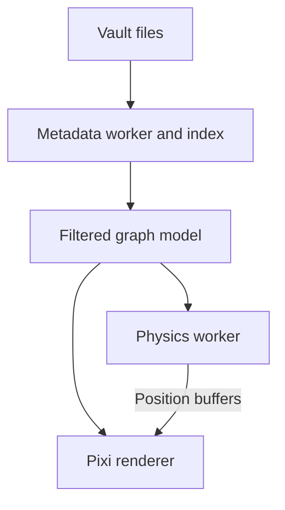

# Obsidian architecture reference for Ivo

This is an original analysis of the locally installed Obsidian **1.15.0** package, inspected on **2026-11-04**. It documents the parts most relevant to Ivo: file-derived metadata, graph construction and rendering, Canvas persistence, and rich-document dependencies. It is a bounded static investigation, supplemented by one explicitly identified companion UI observation, not a claim to have reconstructed the entire application.

The source archive was `/Applications/Obsidian.app/Contents/Resources/obsidian.asar`. Its SHA-256 is `0e6383301078a798f0f3bdb42bdb606d904ada77eab8c8fc89da533573979248`. The accompanying [evidence ledger](evidence-ledger.json) records source-file hashes, byte offsets, short lookup anchors, and evidence classifications. No vendor source files are redistributed. Evidence IDs in this report are local investigation IDs, not REA trace IDs.

## How to read the evidence

- **Artifact observation:** a dependency, literal configuration, or structural fact directly visible in the installed package.
- **Static inference:** behavior inferred by following the inspected code; this still needs runtime acceptance testing.
- **Unknown:** behavior not established by this investigation.

All behavior below is static inference unless explicitly described as an artifact observation. A packaged default is not evidence of the user's current setting. The ledger's inspection windows locate relevant code; some findings required following adjacent methods in the same source file.

## 1. Source files and derived knowledge

Obsidian separates persistent note files from a derived metadata index. The metadata-cache object owns file and parsed-content caches, a work queue, a normalized file lookup, and separate `resolvedLinks` and `unresolvedLinks` maps. A dedicated **Metadata Cache Worker** is directly observable in the package. [A01–A07]

The worker's parser extracts links, embeds, tags, headings, sections, list items, block identifiers, frontmatter, frontmatter links, footnotes, footnote references, and reference-style links. Many records retain source positions, including line, column, and offset. The block index normalizes IDs while preserving original data. Frontmatter link extraction visits nested arrays and objects. This metadata supports several surfaces without making each surface parse the entire vault independently. [A02]

Resolved adjacency is indexed by source file and destination file, with a count of references for each pair. Unresolved destinations are tracked separately by normalized link name. Consequently, an uncreated page can participate in the knowledge model before a file exists. Resolution uses a case-normalized lookup and source-relative candidate ranking, including extension and relative-path handling. The complete ambiguity rules have not been proven here. [A03, A04]

Tag aggregation expands slash-separated ancestors and merges case variants. This is distinct from merely searching for an exact `#token` in each file. The display spelling appears to be selected from observed spellings by frequency. [A05]

### Cache and invalidation

The inspected cache initialization uses IndexedDB file and metadata stores. File records retain path, modification time, size, and content hash; parsed metadata is keyed by content hash. Initialization checks file state and the availability of corresponding parsed metadata. Content that needs recomputation goes through the worker queue; a known hash can reuse existing parsed results. This makes the database a rebuildable acceleration layer rather than the only copy of the note. [A06, A07]

Rename handling moves relevant cache entries and refreshes affected references. Delete handling invalidates metadata and affected link-resolution work. These observations concern index maintenance; they do **not** establish every automatic rewrite of link text in the underlying documents. [A25, A26]

## 2. The graph is a projection of metadata

The global graph is derived from the indexed vault rather than saved as a second canonical relationship database. Construction combines file nodes, resolved relationships, optional unresolved nodes, optional attachment nodes, and optional tag nodes. Files excluded by the applicable exclusion logic are omitted. Multiple references between the same source and target collapse into a boolean adjacency edge for this graph. The index can therefore know more than the visualization expresses. [A08]

The package defaults observed around this code are: attachments off, tags off, unresolved nodes visible, orphans visible, local depth one, local incoming and outgoing traversal enabled, and local interlinks off. These are implementation defaults, not runtime measurements or a recommendation for Ivo.

Local graph construction begins at a center node and expands incoming and/or outgoing neighborhoods to the configured depth. Tag nodes do not themselves become traversal sources. Local weights decrease with distance from the center; the center receives a weight of 30. The interlinks option adds the other relationships between already selected neighborhood nodes. [A09]

Orphan filtering considers valid non-self incoming and outgoing relationships. A self-reference alone does not count as connection to another node. Global node sizing uses unique graph degree, transformed by a square root and bounded before the user multiplier; local graphs can supply explicit weights instead. [A10, A14]

### Filtering, coloring, and navigation

Graph queries reuse the search machinery. Query changes cancel the previous queue. Matching may read file contents incrementally and yield during work, with intermediate redraws. The inspected implementation includes a 250 ms query debounce and approximately 333 ms intermediate render cadence. Ordered color groups share this matching pipeline; the first matching group supplies the color after the base filter is satisfied. These are responsiveness mechanisms, not measured latency guarantees. [A11]

Graph views respond to metadata and file events rather than requiring the user to rebuild the graph manually. File-node activation routes through workspace link opening; tag-node activation routes to tag search. Hover support is connected to the preview mechanism. A global graph and a local graph can therefore share the same underlying index and renderer while presenting different selections.

## 3. Rendering and physics have different responsibilities

The package directly contains Pixi and constructs a `PIXI.Application` for the graph, with antialiasing enabled and automatic startup disabled. It also creates a named worker for `sim.js`. These establish a GPU-oriented canvas renderer and an independent physics worker, rather than a graph made from thousands of normal document elements. [A12, A16]

### Preserving continuity during updates

The graph renderer reconciles node IDs against existing node objects, removes missing nodes and edges, and keeps existing objects and positions where possible. New nodes are seeded near known neighbors, with a perturbation, or around the existing field if no neighbor position is available. Structural changes update the worker topology and restart its motion. This avoids a complete positional reset on every metadata change. [A14]

The frame callback applies new positions, pan/zoom interpolation, and viewport calculations. It limits initialization of previously unrendered node graphics to **50 per frame**, prioritizing proximity to the viewport center. Rendering methods hide off-screen node/link graphics using viewport checks. This is evidence of visibility control, not proof that off-screen GPU resources or node objects are destroyed. [A13]

The callback uses animation frames and stops scheduling after more than 60 idle frames; changes reset that idle state. Labels have independent styling and visibility logic, including zoom-dependent fading and hover/selection emphasis. The graph's label font stack is separate from ordinary note text. CSS-derived colors are read into the renderer, so note typography and graph typography should not be treated as a single styling system. [A13, A15]

### Physics transport

`sim.js` selects a WebAssembly-backed implementation where available, then a JavaScript fallback with d3-style force and spatial-index structures. The fallback includes link, charge, centering, and collision behavior. The exact upstream force-library version is not established by this inspection. [A17]

The worker accepts topology updates, dragged-node constraints, force settings, alpha/alpha-target, and run-state changes. Positions are packed in a `Float32Array`. The code attempts shared-memory transport and otherwise uses transferable array buffers; node identifiers accompany position data, and the shared path has a version counter. The simulation loop targets roughly 60 updates per second while active and cools toward a threshold. Actual cadence, available memory mode, selected physics path, and achievable graph size remain runtime questions. [A17, A18]

## 4. Canvas is a separate authored document

Canvas persists explicit node and edge arrays as JSON. Import dispatch recognizes file, text, link, and group nodes. Nodes have IDs, geometry, color, and type-specific content. Edges store their own IDs and endpoint/side information. The model retains additional data while reconstructing known node types. The view serializes this data and parses it when restoring the document. [A19–A21]

This is a different contract from graph view: Canvas records an arrangement authored by the user; graph view projects relationships derived from vault content. Shared visual ingredients do not imply shared persistence or identical backlink semantics.

**Companion runtime observation, Obsidian 1.15.0.** In the [test vault](../../tests/fixtures/obsidian-vault/Reference.canvas), a standalone Canvas text card contains `[[Atlas]]`. The UI investigation observed Atlas's Backlinks panel grouping that card's matching text under `Reference.canvas`; together with the link from `Material.md`, the status showed two backlinks. This establishes outgoing-link indexing under the **Canvas file** for this fixture. It does not make the standalone card an independent note, graph node, or link target. [R01]

For Ivo, the useful separation is **semantic relationship graph versus authored page layout**. A magazine spread can position images and text without those coordinates becoming knowledge-graph coordinates. The same document can appear as one node in the graph while retaining its own sophisticated internal layout.

## 5. Rich-document dependencies

The following are direct package observations, with integration inferences kept separate:

| Component | What is established | What is not established |
|---|---|---|
| PDF.js | Local viewer/worker assets; package version metadata reports **5.3.34**; the loader configures a worker. [A22] | A general editable-PDF authoring system, or every annotation behavior. |
| MathJax | Local MathJax bundle, fonts, and chemistry-related assets; separate loading and configuration for mathematical rendering. [A23] | A complete LaTeX document compiler or parity with arbitrary TeX packages. |
| CodeMirror | A CodeMirror library is present in the archive; editor-related symbols also exist in the main application. | That this packaged legacy library alone drives every current editor route. |
| CSS | Document line measure is configurable through `--file-line-width`; the inspected default is 700 px. [A24] | That a theme alone can supply a structured magazine page model. |

Academic typography and scientific semantics can be introduced independently. Ivo can support excellent serif typography now, reserve typed equation/citation/figure blocks in its document schema, and add math rendering later. A PDF renderer should likewise be an embedded-media component before it becomes an annotation editor.

## 6. Decisions this supports for Ivo

| Ivo concern | Architectural implication |
|---|---|
| Fast access | Keep a rebuildable metadata index and search index; avoid reparsing every document on each graph or navigation update. |
| Smooth graph | Keep physics off the main thread; reconcile stable IDs; preserve positions; batch additions and visibility work; stop rendering when idle. |
| Useful connections | Distinguish page links, embeds, tags, and unresolved targets in the data model even if a particular view simplifies them. |
| Rename safety | Prefer stable document IDs for internal relationships, with readable names/paths for interchange; explicitly test imported path links. This is an Ivo design choice, not an observed Obsidian ID model. |
| Beautiful documents | Separate semantic rich content from layout metadata. Let typography, column arrangements, image crops, captions, and spacing be authored without changing graph topology. |
| Portable ownership | Persist documents and media in an open, versioned format; treat caches and graph positions as disposable or separately versioned state. |
| Phone and computer | Put persistence behind a storage interface. A browser-local MVP is not evidence that Drive/Dropbox synchronization is solved. Test concurrent writes and conflict recovery before promising seamless sync. |
| Scientific growth | Reserve typed nodes and extension hooks for equations, citations, figures, references, and PDF annotations; avoid embedding those concepts as opaque decorative HTML. |

The immediate lesson is not to duplicate every Obsidian subsystem. Its separation of source documents, derived metadata, graph projection, physics, rendering, and authored Canvas data is a strong reference for building a smaller system with a different visual ambition.

## 7. Remaining verification

This investigation does not establish mobile parity, actual graph performance, complete search grammar, every ambiguous-link rule, plugin isolation, sync conflict semantics, complete PDF interactions, or the full editing engine. The static inspection did not modify the installed application or the user's notes; the companion UI check used a controlled fixture. Runtime fixtures should subsequently verify rename/delete behavior, unresolved-target creation, incoming/outgoing depth, tag ancestry, filter/group ordering, and graph behavior under large incremental changes. Performance targets should be measured on Ivo's chosen desktop and phone hardware rather than inferred from Obsidian's source structure.
