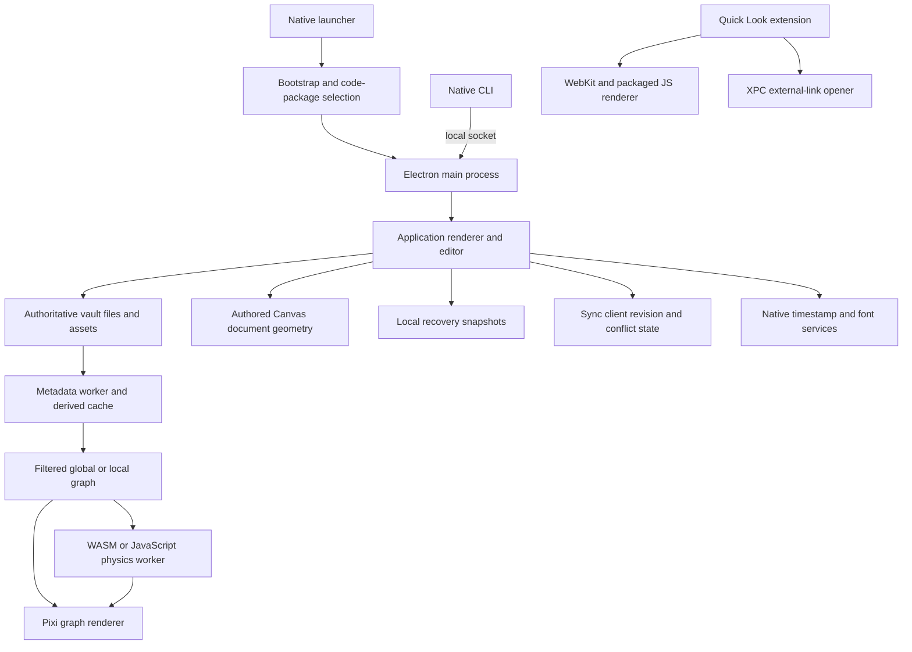

# Obsidian investigation for Ivo

Target: locally installed **Obsidian 1.15.0 for macOS**, inspected 4 November 2026. This is the consolidated closeout for the package investigation: native binaries and disassembly/decompilation, WebAssembly, bootstrap/application code, dependencies, and the previously recorded controlled UI fixture. It supersedes the earlier four-JavaScript-file scope as the index to the completed work.

This study establishes how the inspected package is organized and how the principal Ivo-relevant behaviors are implemented. It does not claim a compatible Obsidian replacement, recovery of original source, or verification of every runtime path. All raw proprietary bytes, native pseudocode, decoded WASM, and full REA records are retained privately in the parent workspace's `work/obsidian-deep/` and `work/rea-evidence/` directories. Public project documents contain original findings and source/evidence references.

## Read the results

| Report | What it establishes |
|---|---|
| [Native inventory](native-inventory.md) | All identified Mach-O containers and both slices, identities, plists, signatures, dependency resolution, and Electron fuses. |
| [Native disassembly/decompilation](native-decompilation.md) | Actual launcher, CLI, timestamp/font binding, Quick Look, and XPC call-flow reconstruction, with assembly and pseudocode. |
| [Native evidence index](native-evidence-summary.json) | The 29 function evidence IDs, target hashes, addresses, available facets, and twelve full-section transcript digests. |
| [WebAssembly investigation](wasm-investigation.md) | All three identified modules decoded/validated; graph algorithm and host contract; PDF image/color boundaries. |
| [Application evidence summary](application-analysis-summary.json) | Per-run IDs, source processing counts, timeouts, and integrated native handoffs. |
| [Application investigation](application-investigation.md) | Bootstrap updates, save/watch/index/rename/recovery paths, editor/Canvas/media, plugin boundaries, CLI dispatch, and sync client/conflicts. |
| [Earlier architecture reference](architecture.md) | Detailed graph selection, rendering/physics separation, metadata schema, and Canvas observations with manual source locators. |
| [Behavior reference](behavior-reference.md) | Documented behavior and a future acceptance matrix. This matrix is not a list of tests already passed. |
| [Runtime verification](runtime-verification.md) | Exactly which controlled fixture behaviors were observed in the application. |

## Findings that matter to Ivo

**Canonical files and derived state are separate.** Desktop notes and media are filesystem data. Metadata, link resolution, search-related caches, local recovery, and sync coordination are distinct structures. Content hashes let parsed metadata be reused. Watchers reconcile filesystem state rather than treating each OS event as complete truth. Ivo should preserve that separation as its file-backed format evolves.

**Save completion, recovery, and synchronization have different guarantees.** The inspected ordinary note path performs queued filesystem writes. It does not establish a temporary-file/rename transaction and fsync guarantee around each save. Local recovery adds timed text snapshots and selected pre-replacement backups; filesystem trash is another system. Ivo's own atomic manifest commits are an independent design choice. They still need recovery, retention, and concurrent-writer policies.

**The graph is derived; page geometry is authored.** Resolved/unresolved links, tags, attachments, filters, and local neighborhood policy produce a graph model. Rendering and physics consume that model. Canvas saves explicit geometry. The decoded graph WASM is only 3,322 bytes and handles numeric layout state, not document content. Its small size demonstrates why executable volume alone is a poor measure of architectural importance.

**Textual links need resolution policy and rename transactions.** Source-relative ranking, extension/path handling, and candidate order can determine which file a link means. Rename waits for metadata/link work, records old meaning, and selectively updates references after the move. Ivo's stable IDs avoid some of that ambiguity, while imported path links still require explicit rules and fixtures.

**Native services are specific boundaries.** Timestamp updates, asynchronous font-family discovery, a terminal/socket CLI client, and a WebKit Quick Look preview each have a narrow role. The CLI delegates commands into the desktop app. Quick Look uses native file/lifecycle management around a JS renderer and a separate XPC link-opening service. These are concrete integration examples for Ivo's shared-renderer strategy.

**Sync is a subsystem, not a folder-copy option.** The inspected client keeps local/server revision state, hashes, pending changes, encrypted transport, and conflict/recovery paths. Divergent Markdown can use base/local/remote patch merging or conflicted copies. That is not a demonstrated character-operation CRDT. Server behavior, mobile background work, and end-to-end interoperability need separate evidence; the client code alone cannot establish them.

## Identity and interpretation

The main installed archive's SHA-256 is `0e6383301078a798f0f3bdb42bdb606d904ada77eab8c8fc89da533573979248`. The versioned application-support code archive found during the study has exactly the same bytes, removing one possible installed-versus-updated-package ambiguity for this session. No personal vault, plugin directory, account database, or credential content was read.

ASAR header integrity hashes match their plist declarations. The two unpacked native bindings still contradict their ASAR-declared hashes/sizes, and local code-signature verification fails for the installed arm64 native images. The investigation retains those facts and analyzes the observed local bytes; it does not establish the cause or assert vendor authenticity. Signature display metadata alone is not signature verification.

The previous automatic core summary reported zero explicit BrowserWindow web preferences. Deeper source reading found the assembled settings, including privileged app-renderer Node integration and a separate tightened embedded-webview boundary. Likewise, automatic module traces with no outgoing edges were not treated as proof of absent behavior. The native timestamp diagnostic's “seconds” wording was corrected by following the actual millisecond conversion instructions. These examples show why counts, strings, and tool summaries require reconciliation with the underlying evidence.

## Completion and evidence limits

| Question | Disposition |
|---|---|
| Which native components are shipped, and which architectures do they contain? | Completed inventory: 20 Mach-O containers / 40 slices, with hashes and roles. |
| Was actual native disassembly/decompilation performed? | Yes: twelve complete `__text` section disassemblies for six integration targets, plus 29 arm64 Hopper/REA function dossiers. Native instructions and reconstructed pseudocode were reviewed. |
| What do the native integration components do? | Launcher, timestamp/font boundaries, CLI transport/dispatch, Quick Look preview, and XPC opening paths reconstructed at the described static scope. |
| What are the WASM modules and how does graph physics work? | All three identified modules validated; all 348 defined bodies decoded; all seven graph routines followed; PDF glue and interfaces mapped. |
| Do the shipped JavaScript files parse, and how much did REA process? | All 46 passed independent Node syntax checks without execution. REA processed 44/46, including all 15 bootstrap files and all nine top-level application entrypoints. OpenJPEG's JavaScript fallback and Prism hit per-source time limits; dynamic/retention limits remain for other processed files. |
| How do persistence, metadata, links, rename, recovery, editor/Canvas, plugins, and sync client interact? | Principal paths traced and source-located; detailed findings and automatic extraction limits recorded in the application report. |
| Were all observed behaviors exercised at runtime? | No. The existing isolated fixture verifies its recorded link/embed/backlink/rename cases. Static decoding does not establish execution, performance, adversarial correctness, or device behavior. |
| Were every Electron/Chromium/graphics/media implementation and every compiler-generated native routine reconstructed? | No. All shipped native components were inventoried; deep native reconstruction focused on the six integration targets. Upstream engines remain dependencies with identified boundaries. |
| Are all dynamic call graphs, source types, and edge cases known? | No. Static analysis retains unresolved dynamic calls, resource/retention limits, guessed native types, and explicit edge cases. |
| Are sync servers, private protocol compatibility, physical iPhone/iPad behavior, arbitrary plugins, and future updates verified? | No. They are outside the evidence supplied by this pinned installed macOS package and the controlled fixture. |

The completed result is an evidence-backed architecture and implementation study of this installed package, including the native and WASM work missing from the earlier pass. Future compatibility/performance work should use the named unknowns as test questions, while retaining these findings instead of restarting the investigation.
