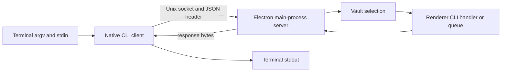

# Obsidian native disassembly and decompilation

Inspected 4 November 2026: the installed macOS Obsidian 1.15.0 bundle. This pass performed actual Hopper disassembly/decompilation through REA, followed by instruction-level checks using Apple's LLVM disassembler. It goes beyond Mach-O headers, imports, strings, or a JavaScript-only study. Source bytes were not executed or modified.

The [native inventory](native-inventory.md) covers every identified native container and both CPU slices. This report follows six integration targets: the launcher, CLI, timestamp binding, font binding, Quick Look extension, and its link-opening XPC service. Their complete `__text` sections were disassembled for both arm64 and x86_64, yielding twelve private LLVM transcripts. Selected arm64 routines additionally have REA/Hopper function dossiers with assembly, pseudocode, basic blocks, references, and call relationships. The [native evidence index](native-evidence-summary.json) records each actual evidence ID, target hash, entry address, and available facets.

All raw code, snapshots, decoded instructions, and pseudocode are private under the parent workspace's `work/obsidian-deep/native/`. They are not included in Ivo. The public findings below are original descriptions. Existing Ivo application code was not changed during this investigation.

## 1. The native launcher delegates to Electron

The arm64 launch entry is `0x100000460` (`launcher-entry`). It preserves argc/argv, calls the standard-stream initializer, checks Electron's RunAsNode fuse, and then calls either ElectronMain or the Node startup entry based on that fuse and the nonempty ELECTRON_RUN_AS_NODE environment variable. Actual packaged fuse inspection reports RunAsNode disabled. The presence of a Node-startup branch therefore does not show that this installed package permits that mode.

The initializer at `0x1000004c0` (`launcher-stdio`) checks descriptors 0, 1, and 2 with fstat. If a descriptor is invalid with EBADF, it reopens the corresponding standard stream on `/dev/null`. The launcher contains process/bootstrap code; it is not where the document editor, metadata model, or graph selection is implemented.

**Evidence:** `launcher-entry`, `launcher-stdio`; matching complete arm64/x86_64 disassemblies; fuse facts in the native inventory. This is static control flow, not an observed application launch.

## 2. Filesystem creation-time updates cross a small native boundary

The universal `btime/binding.node` image has a JavaScript-facing N-API callback at arm64 `0x6d8` and an exported helper at `0x660` (`btime-callback`, `btime-set-time`). The callback checks the argument count and argument kinds, obtains a buffer path and int64 timestamp, calls the filesystem operation, and returns a numeric status. Error paths involve N-API error creation and propagation.

The helper's assembly sets the attribute bitmap count to 5 and common attribute mask to `0x200`, then calls setattrlist with a 16-byte timespec payload. The installed macOS SDK's `sys/attr.h` defines these as ATTR_BIT_MAP_COUNT and ATTR_CMN_CRTIME. The arithmetic computes seconds from the supplied value divided by 1,000 and nanoseconds from the remainder multiplied by 1,000,000. Those instructions establish a **millisecond input converted to a filesystem creation time**. The callback inlines the same operation.

The argument-error string says “seconds btime.” That string is weaker evidence than the conversion instructions. The wrapper and application adapter corroborate milliseconds: the wrapper accepts a nonnegative bounded integer, rejects empty/NUL-containing paths, and creates a NUL-terminated UTF-8 buffer; the application passes ctime directly while dividing mtime by 1,000 for fs.utimes. The wrapper throws on nonzero native status. The native code does not implement note serialization, version history, or synchronization.

**Evidence:** `btime-set-time` = `ev_bb8f5e650a13a6acc27a735f80548e58deb1bda3891a3b56b42d74159a90b463`; `btime-callback` = `ev_425d6c3ae8ac6010be66f4708991f2d5b576226e56ba3acf65cdec8c52507a87`; wrapper/adapter anchors and integrated REA handoff in the [application investigation](application-investigation.md). The digest is that of the locally observed universal binding, whose ASAR integrity discrepancy is retained separately.

## 3. Font discovery is asynchronous native enumeration

The `get-fonts/binding.node` path is a short wrapper around a N-API AsyncWorker:

1. `font-js-boundary` (`0x910`) constructs FontWorker, queues native asynchronous work, and returns its JavaScript promise value.
2. `font-worker-create` (`0xd04`) initializes the asynchronous worker and promise/deferred state.
3. `font-worker-execute` (`0x1160`) branches to the enumeration routine.
4. `font-enumeration` (`0x3374`) constructs an available-font collection through CoreText, obtains matching descriptors, copies the font-family attribute, and collects UTF-8 family-name strings. It releases the acquired Objective-C/CoreFoundation resources along the inspected path.
5. `font-worker-result` (`0x1168`) creates a JavaScript array, converts the collected names, sets the array entries, frees copied name buffers, and resolves the deferred. `font-worker-error` (`0x12fc`) rejects it with an error value.

This establishes system **font-family discovery**, with asynchronous scheduling and a JS array result. It does not establish font-file export, font embedding, exhaustive font-style enumeration, or support for a particular missing font. The static collection loop does not by itself establish sorting or deduplication policy in the UI.

**Evidence:** the six `font-*` dossiers and matching JS/native integrated handoff. The enumeration dossier is `ev_0f78f9a8f5362cd47eb6cd0a8d6f81a12ed35c0ed2dda93bc52150bce3c863ec`.

## 4. The CLI is a transport client for the desktop application

The separate `obsidian-cli` executable was absent from the earlier four-file analysis. Its main at arm64 `0x100000598` (`cli-main`) reads HOME and constructs a local Unix-domain stream socket path ending in `.obsidian-cli.sock`. If connection setup fails, it emits a message asking the user to ensure Obsidian is running and exits with failure.

On success it obtains the current directory and sends a newline-delimited JSON header containing argv, tty, and cwd. The JSON-string routine at `0x100000984` (`cli-json-escape`) handles quoted-string encoding. It detects interactive input/output; in the interactive case it saves terminal settings and switches to raw mode. Two pthread routines then relay bytes: `cli-stdin` (`0x100000e14`) reads standard input into a bounded buffer and handles partial writes to the socket; `cli-response` (`0x100000ef0`) reads from the socket and handles partial writes to standard output. Shutdown cancels/joins the input thread, restores terminal settings where applicable, shuts down the socket, and closes it. Signal handlers and output buffering are visible in the full disassembly.

The main application's JavaScript provides the other side: it opens the same socket, parses the initial header, checks whether CLI handling is enabled, resolves a vault from an explicit selector/current directory, then dispatches into the relevant renderer's CLI handler or queue. Thus a CLI command can enter the application command system through IPC; this executable is not an independent note database or a second copy of the editor.

**Evidence:** four `cli-*` native dossiers and complete disassembly; socket/server/renderer anchors in the application report. The main dossier is `ev_25913f19f28ec93c979853acc7aac1b1eb418c0dc7a3c1f794d4c9bc686e357c`. This describes the transport and dispatch found in local bytes; no command was issued against a user's live vault.

## 5. Quick Look is a native WebKit preview pipeline

The Swift Quick Look extension is a substantial additional integration surface. Its prepare-preview routine at `0x10000869c` (`preview-prepare`) creates a fresh request identity, resets previous navigation/watchdog state, reads file content, handles file-size/encoding/read errors, locates renderer resources, loads those resources, creates or reuses a WebView, loads the preview page, and starts timeout/watchdog state. The static path contains a file-too-large error branch. This report does not assert an exact accepted-size limit or that every OS request takes the same path.

`preview-webview` (`0x100007d18`) creates a WKWebView configuration with a nonpersistent website data store, a custom `obsidian-preview` resource scheme, separate renderer/visibility script-message handlers, and a navigation delegate. An injected visibility listener communicates document visibility to native code. The preview renderer is supplied from packaged resources; it is not a second native rich-text editor.

The resource loader at `0x100003580` and directory walk at `0x100003684` (`preview-load`, `preview-directory`) resolve filesystem URLs and build a map of allowed resource handles. The walk follows resolved-path containment checks and symbolic-link/directory handling. Scheme-task code at `0x1000052e8` (`preview-scheme`) maps requests to those resources, reads bytes, derives MIME information, and reports responses/errors through WebKit's scheme-task API. These checks are static observations, not a completed adversarial filesystem/security test.

`preview-bridge` (`0x100006534`) checks that a script message comes from the main frame, obtains the controller, and forwards the body with the sending WebView. `preview-message` (`0x10000a064`) additionally compares the WebView and parses a typed host message before dispatching the preview, stopping the watchdog on a rendered message, or finishing with an error. `preview-dispatch` (`0x10000a2e0`) passes a typed event name/detail object into the page with WKWebView.callAsyncJavaScript. That makes the cross-language contract explicit: native file/resource/lifecycle management surrounds a JavaScript-rendered preview.

`preview-navigation` (`0x10000c744`) separates preview-scheme navigation from clicked external links and routes the latter to the external-opening path. The native static string array used for external schemes contains https, http, and mailto. That array was checked in the original arm64 file bytes at VA `0x100019700`, absolute universal-file offset 317,184; the same three entries appear in the XPC service's array at VA `0x10000c718`, original-file offset 149,272. This avoids inferring the allowlist from garbled Swift decompiler text.

**Evidence:** ten `preview-*` dossiers, complete arm64/x86_64 disassemblies, and the source-byte map retained privately as `scheme-array-bytes.json`. The original target hashes and each dossier ID are in the evidence index. The JS renderer-side contract is covered in the application report.

## 6. External links cross a separate XPC boundary

The extension's `preview-external` routine (`0x10000b090`) contains XPC connection/interface/proxy setup and response/error handling, as well as alternative OS opening APIs. The separate `ObsidianQuickLookLinks` executable's main (`0x1000033a0`, `xpc-main`) starts an NSXPCListener with a LinkOpener delegate.

The listener method at `0x100003264` (`xpc-accept`) sets an exported interface for the link-opening protocol, exports its object, resumes the connection, and returns true. The link method at `0x1000034f0` (`xpc-open-link`) reads/lowercases the URL scheme and checks the three-entry scheme array. An unaccepted scheme replies false; an accepted scheme schedules work on the main dispatch queue. Its dispatched closure and completion callback (`xpc-workspace-open`, `xpc-workspace-result`) use NSWorkspace's URL-opening operation and reply with the resulting success/failure.

This is a narrow native link-opening service. The observed listener routine does not contain a caller-identity check; sandboxing, service accessibility, framework behavior, and exploitability cannot be concluded from that single routine. The inventory's entitlements and bundle roles supply context but do not replace a runtime authorization test. No arbitrary URL was opened during this static investigation.

**Evidence:** five `xpc-*` function dossiers and `preview-external`; native bundle/plist/entitlement evidence in the native inventory.

## Reliability and coverage

Hopper's arm64 function dossiers are reconstructed observations, not original C/C++/Swift source. Several large Swift routines produce duplicated branches, incorrect local types, and nonsensical selector placeholders in pseudocode. Conclusions above use call sites, instructions, original static data, and corroborating JS/SDK facts where necessary. A guessed signature is not a recovered source type. Constant operands can appear as Hopper reference candidates; they were not automatically promoted to real call edges.

Hopper's public API does not expose complete native function body ranges through these dossiers. The separate full-section LLVM disassemblies preserve both slices for the six targets, but a decoded instruction listing is not proof of runtime reachability or understanding of every compiler-generated routine. Native value-flow/API facets that the provider leaves unavailable remain unavailable. No live process attach, target code invocation, code-signature modification, fuse modification, or global REA configuration change occurred.

The other native components are inventoried in full and their dependency roles identified: Electron/Chromium, graphics/media libraries, renderer/GPU helpers, and update/crash infrastructure. This pass does not reconstruct every implementation detail of those upstream engines. Their existence must not be confused with additional proprietary document/graph logic.

Completed for this pass: both-slice native inventory, actual full-section disassembly of the six integration targets, selected function-level native decompilation, JS/native evidence linkage, launcher/CLI/font/timestamp/Quick Look/XPC flow reconstruction, and source-bound evidence preservation. Unresolved questions are named in the overall investigation closeout and must not be described as tested merely because assembly was generated.
